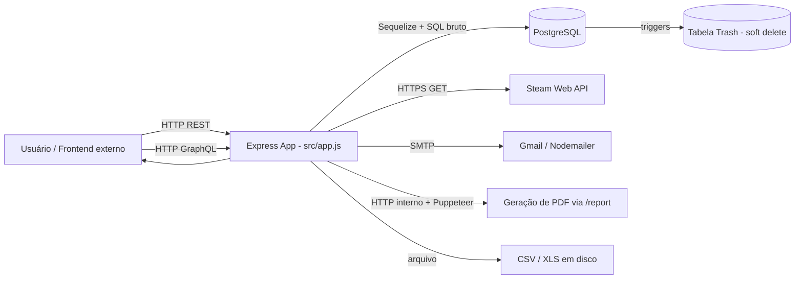
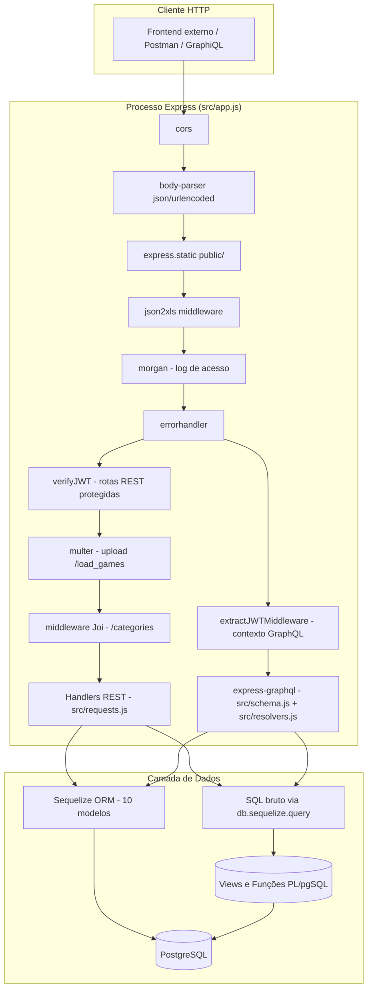
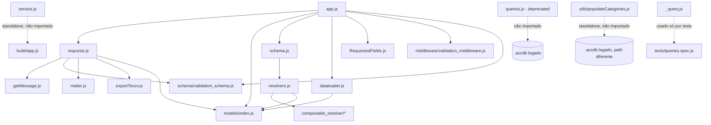
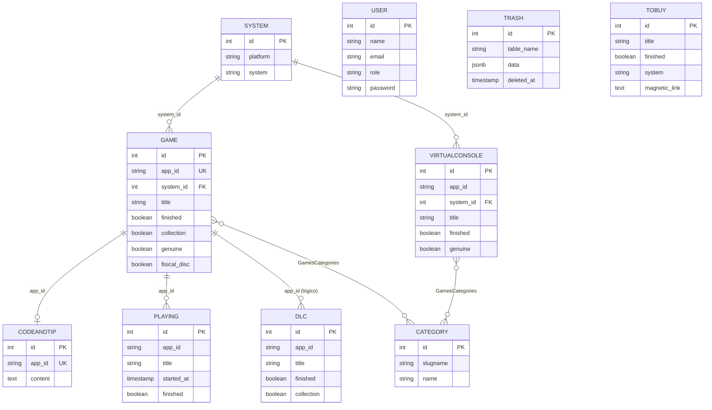
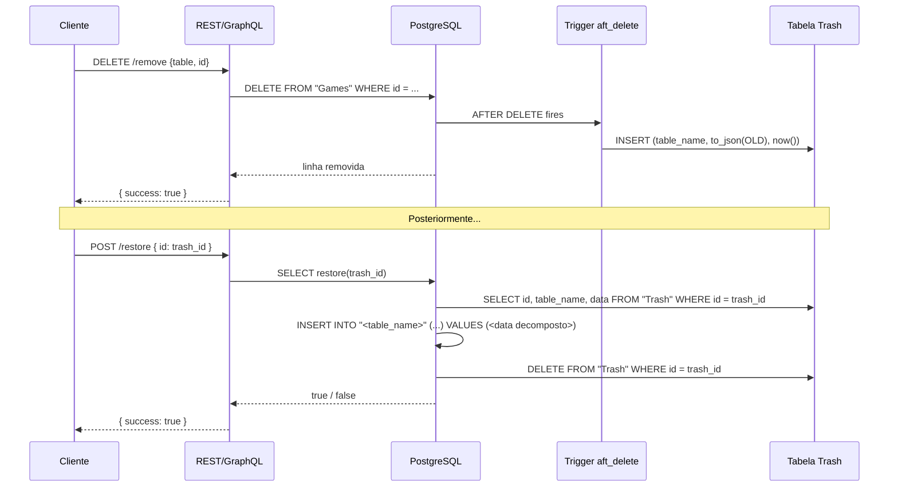
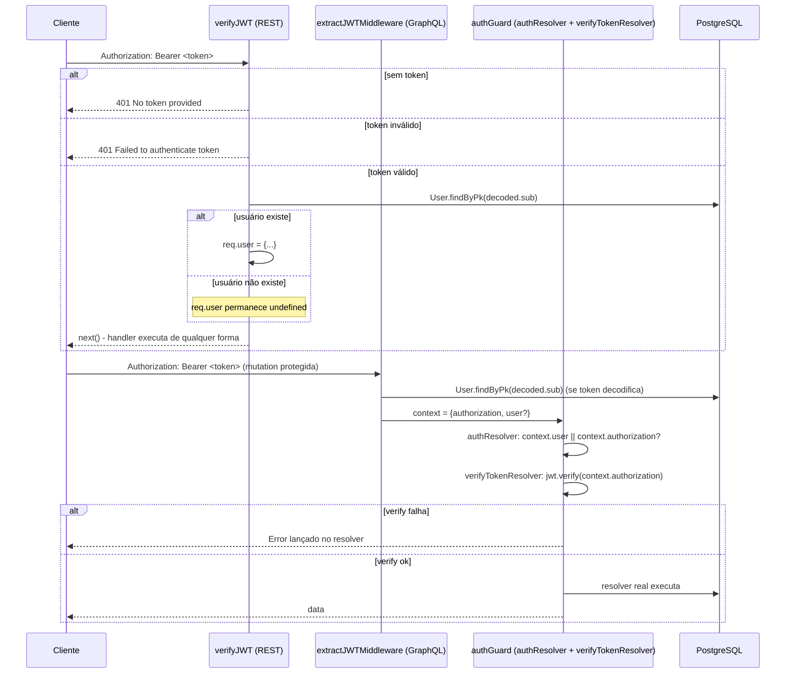

# SPECIFICATION.md — game-resume-backend

> Documento mestre de Specification-Driven Development (SDD). Derivado por engenharia reversa do código-fonte (fonte da verdade) na raiz `D:\Packsys\NetBeansProjects\game-resume-backend`. Nenhuma correção de comportamento foi feita ao documentar: divergências, bugs e comportamento implícito são registrados como tal, nunca silenciados.
>
> **Versão:** 1.0 · **Data:** 2026-10-31 · **Commit de referência:** `ea6268ead05341bafb3821647e62169358469292` (`ea6268e`, 2022-05-02) · **Idioma:** pt-BR, identificadores de código preservados no original.

## Índice

1. [Visão Geral do Sistema](#1-visão-geral-do-sistema)
2. [Arquitetura](#2-arquitetura)
3. [Regras de Negócio](#3-regras-de-negócio)
4. [Casos de Uso](#4-casos-de-uso)
5. [Modelo de Domínio](#5-modelo-de-domínio)
6. [Banco de Dados](#6-banco-de-dados)
7. [APIs](#7-apis)
8. [Telas](#8-telas)
9. [Segurança](#9-segurança)
10. [Integrações](#10-integrações)
11. [Processos Assíncronos](#11-processos-assíncronos)
12. [Configurações](#12-configurações)
13. [Logs e Auditoria](#13-logs-e-auditoria)
14. [Requisitos Funcionais](#14-requisitos-funcionais)
15. [Requisitos Não Funcionais](#15-requisitos-não-funcionais)
16. [Critérios de Aceitação](#16-critérios-de-aceitação)
17. [Testes](#17-testes)
18. [Observabilidade](#18-observabilidade)
19. [Dívida Técnica](#19-dívida-técnica)
20. [Roadmap de Modernização](#20-roadmap-de-modernização)
21. [Matriz de Rastreabilidade](#21-matriz-de-rastreabilidade)
22. [Glossário](#22-glossário)
23. [Anexos](#23-anexos)
24. [Histórico de Versões](#24-histórico-de-versões)
25. [Aprovações](#25-aprovações)
26. [Regra Final](#regra-final)

---

## 1. Visão Geral do Sistema

### 1.1 Objetivo

O `game-resume-backend` é o backend de um sistema de inventário e acompanhamento pessoal de uma coleção de videogames ("My Games Resume" — ver `src/service.js`, `description: 'Backend do My Games Resume'`). Ele registra, para cada jogo possuído (físico ou digital, em múltiplas plataformas), se foi concluído, quando, se é cópia original ("genuine"), se faz parte de uma coleção maior (bundle/edição), e permite buscar, categorizar por gênero, acompanhar o progresso de jogos em andamento (`Playing`), registrar DLCs, anotar códigos/dicas (`CodeAndTip`), manter uma lista de desejos (`ToBuy`) e gerar relatórios/estatísticas/exports.

### Problema de negócio

Sem este sistema, o controle de uma coleção de jogos espalhada por múltiplas plataformas (Steam, Origin, Ubisoft/Uplay, GameCube, Wii, WiiU, Virtual Console) e com itens físicos e digitais se torna inviável de rastrear: não há visão unificada de "o que tenho", "o que já terminei", "o que estou jogando agora" ou "quanto da minha coleção por plataforma eu já zerei". O sistema resolve isso centralizando tudo em um único banco relacional com uma camada de normalização (`system_id` + tabela `System`) e views que agregam estatísticas por plataforma e por gênero.

### Público-alvo

Usuário único ou pequeno grupo de usuários autenticados (`User.role`, mas sem autorização diferenciada por papel — ver [DT-006](#19-dívida-técnica)), consumindo a API a partir de um frontend não incluído neste repositório (ver [Seção 8](#8-telas)). O seeder `src/migrations/create_user.sql` cria um único usuário administrador (`Felipe Rodrigues Michetti`), sugerindo um sistema de uso pessoal/doméstico, não multi-tenant.

### Benefícios

- Visão unificada da coleção através de múltiplas plataformas, com classificação automática de plataforma/sistema via função de banco (`which_platform`, `which_system`).
- Estatísticas agregadas (totais, percentuais, por gênero, por data de conclusão) prontas via views SQL, sem necessidade de processamento em memória.
- Importação de jogos diretamente da Steam (API oficial) e de planilhas Excel.
- Exportação para CSV, XLS e PDF (relatório HTML renderizado e convertido via Puppeteer).
- Histórico de exclusões recuperável (mecanismo de "lixeira" via trigger + tabela `Trash`).

### 1.2 Escopo

#### Incluído

- API REST (`src/app.js`/`src/requests.js`) com 52 rotas cobrindo CRUD de jogos por plataforma, categorias, DLCs, lista de desejos (`ToBuy`), sessões de jogo (`Playing`), códigos/dicas, estatísticas, gráficos, busca, exportação (CSV/XLS/PDF), envio de e-mail, sincronização com Steam, autenticação JWT e gestão de usuários.
- API GraphQL (`src/schema.js`/`src/resolvers.js`) com 70 campos (42 `Query` + 28 `Mutation`) cobrindo essencialmente o mesmo domínio, mas com um esquema de tipos próprio e autenticação baseada em composição de resolvers (`authGuard`).
- Persistência em PostgreSQL via Sequelize ORM (10 modelos) e um extenso catálogo de views e funções PL/pgSQL que concentram parte das regras de negócio (ver [Seção 6](#6-banco-de-dados)).
- Integrações externas: Steam Web API, envio de e-mail via Gmail/Nodemailer, geração de PDF via Puppeteer + EJS.
- Scripts de ciclo de vida do banco (`migrate`, `seed`, `create`, `drop`) e instalação como serviço Windows (`src/service.js`, `node-windows`).

#### Não incluído

- Frontend/interface visual — este repositório é exclusivamente backend (ver [Seção 8](#8-telas), marcada `N/A`).
- Multi-tenancy ou separação de dados por usuário — todos os usuários autenticados compartilham a mesma coleção de jogos.
- Qualquer mecanismo de autorização por papel (`User.role` existe mas não é verificado em nenhum lugar do código — [AMB-002](#23-anexos)).
- O módulo legado de acesso a um banco Microsoft Access (`src/queries.js`, marcado `/*Deprecated*/`, e `utils/populateCategories.js`) — presentes no repositório mas não integrados à aplicação (ver [IMP-010](#23-anexos)).

### 1.3 Fluxo Geral



### Contexto corporativo

Projeto de autoria e uso pessoal de Felipe Rodrigues Michetti (commits do repositório, remetente fixo em `src/mailer.js`, usuário seed seeded em `create_user.sql`). Não há indicação de contexto corporativo multi-equipe: não existe pipeline de CI, não há arquivo de licença além de `"license": "ISC"` em `package.json`, e a instalação como serviço Windows (`src/service.js`) aponta para um ambiente de execução doméstico (`C:\DEV\game-resume-backend\build\app.js`).

### Sistemas integrados

| Sistema | Papel | Mecanismo |
|---|---|---|
| Steam Web API (`IPlayerService/GetOwnedGames`) | Importar biblioteca de jogos da Steam | `axios.get` em `requestSteamGames()` (`src/requests.js`) |
| Gmail (SMTP) | Envio de relatórios/avisos por e-mail | `nodemailer` com `service: 'gmail'` (`src/mailer.js`) |
| Microsoft Access (`.accdb`) | Legado de uma versão anterior do sistema | `node-adodb`, **não integrado** à aplicação atual (`src/queries.js`, `utils/populateCategories.js`) |
| PostgreSQL | Armazenamento primário | Sequelize + `pg` driver |

## 2. Arquitetura

### 2.1 Visão Arquitetural

#### Estilo Arquitetural

Monólito modular de camada única de processo: um único processo Node/Express expõe duas superfícies de API (REST e GraphQL) sobre o mesmo banco de dados, sem separação de camada de serviço/domínio explícita — os handlers REST (`src/requests.js`) e os resolvers GraphQL (`src/resolvers.js`) acessam o Sequelize e executam SQL bruto diretamente, sem uma camada de repositório ou serviço intermediária. Parte significativa da lógica de negócio (agregações, classificação de plataforma, soft delete/restore) vive no banco de dados (views, funções PL/pgSQL e triggers), caracterizando uma arquitetura **"lógica no banco" (database-centric logic)** combinada a um monólito HTTP.

#### Tecnologias

| Camada | Tecnologia | Versão (`package.json`) |
|---|---|---|
| Runtime | Node.js (via `@babel/node`/`babel-node`) | não fixada (ver `.babelrc`, `@babel/preset-env` alvo `node: true`) |
| Framework HTTP | Express | `^4.17.1` |
| API Query Language | GraphQL (`express-graphql`, `graphql`, `@graphql-tools/schema`) | `^0.12.0`, `^15.7.2`, `^8.3.1` |
| ORM | Sequelize | `^6.16.2` |
| Driver de banco | `pg` | `^8.7.3` |
| Banco | PostgreSQL | não fixada no código (ver `src/config/config.json`, `dialect: 'postgres'`) |
| Autenticação | `jsonwebtoken` | `^8.5.1` |
| Hash de senha | `bcrypt` | `^5.0.1` |
| Validação | `joi` | `^17.6.0` |
| Upload de arquivos | `multer` | `^1.4.4` |
| Geração de PDF | `puppeteer` + `ejs` | `^13.0.0`, `^3.1.6` |
| Exportação de planilhas | `exceljs`, `json2xls` | `^4.3.0`, `^0.1.2` |
| Exportação CSV | `json2csv` | `^5.0.6` |
| E-mail | `nodemailer` | `^6.7.2` |
| HTTP client (Steam) | `axios` | `^0.26.0` |
| Utilitários | `lodash`, `uuid`, `dataloader`, `graphql-fields` | `^4.17.21`, `^8.3.2`, `^2.0.0`, `^2.0.3` |
| Logs de acesso | `morgan` | `^1.10.0` |
| Tratamento de erro HTTP | `errorhandler` | `^1.5.1` |
| CORS | `cors` | `^2.8.5` |
| Serviço Windows | `node-windows` | `^1.0.0-beta.6` |
| Legado (não integrado) | `node-adodb` | `^5.0.3` |
| Build/transpile | `@babel/cli`, `@babel/core`, `@babel/preset-env` | `^7.8.4` |
| Testes | `jest-cli`, `sinon` | `^27.5.1`, `^13.0.1` |
| Migrations/Seeders | `sequelize-cli` | `^6.4.1` |

Todas as dependências de produção listadas em `package.json` aparecem na tabela acima; não há dependência de produção órfã.

### 2.2 Diagrama Arquitetural



### 2.3 Estrutura de Módulos

| Módulo | Responsabilidade | Depende de |
|---|---|---|
| `src/app.js` | Ponto de entrada: monta middlewares, monta as 52 rotas REST, monta `/graphql`, extrai/verifica JWT. | `requests.js`, `models/index.js`, `schema.js`, `dataloader.js`, `RequestedFields.js`, `middleware/validation_middleware.js`, `schema/validation_schema.js` |
| `src/requests.js` | Implementa os 52 handlers REST: CRUD por plataforma, estatísticas, exportação, autenticação, Steam, e-mail. | `models` (via `db` injetado), `getMessage.js`, `schema/validation_schema.js`, `mailer.js`, `exportTocsv.js` |
| `src/resolvers.js` | Implementa os 70 campos GraphQL (`Query`+`Mutation`) e usa `compose`/`authResolver`/`verifyTokenResolver` como guarda de autenticação. | `composable_resolver/*`, `models` (via `ctx.orm`) |
| `src/schema.js` | Define o SDL GraphQL (types/inputs/Query/Mutation) e liga cada campo ao resolver correspondente; define resolvers de campo (`dlcs` em `WiiUGame`/`WiiGame`/`GameCubeGame`/`SteamGame`/`PCGame`). | `resolvers.js`, `@graphql-tools/schema` |
| `src/models/*.js` | 10 modelos Sequelize (`Category`, `CodeAndTip`, `DLC`, `Game`, `Playing`, `System`, `ToBuy`, `Trash`, `User`, `VirtualConsole`) + `index.js` (bootstrap de conexão). | `sequelize`, `src/config/config.json` |
| `src/dataloader.js` | `DataLoaderFactory`/`DLCLoader`: batcheia buscas de DLCs por `app_id` para evitar N+1 no GraphQL. | `dataloader`, Sequelize raw query |
| `src/RequestedFields.js` | Calcula, a partir da árvore de seleção GraphQL (`graphql-fields`), quais colunas efetivamente projetar no SQL bruto dos resolvers `all*`. | `graphql-fields`, `lodash` |
| `src/composable_resolver/composable.resolver.js` | `compose(...funcs)`: utilitário genérico de composição funcional direita-para-esquerda. | nenhuma |
| `src/composable_resolver/auth-resolver.js` | `authResolver`: barra a chamada se `context.user`/`context.authorization` estiverem ausentes. | nenhuma |
| `src/composable_resolver/verify-token-resolver.js` | `verifyTokenResolver`: valida o JWT do `context.authorization` antes de delegar ao resolver real. | `jsonwebtoken` |
| `src/middleware/validation_middleware.js` | Middleware Express genérico que valida `req[property]` contra um schema Joi. | `joi` |
| `src/schema/validation_schema.js` | Schemas Joi por entidade (`category`, `game`, `tobuy`, `virtualconsole`, `dlc`, `playing`). | `joi` |
| `src/mailer.js` | Encapsula `nodemailer` com remetente/destinatário padrão fixos no código. | `nodemailer` |
| `src/exportTocsv.js` | Gera CSV (`json2csv`) e grava em `exports/<uuid>.csv`. | `json2csv`, `uuid`, `fs` |
| `src/report.ejs` | Template EJS renderizado por `showReport`, consumido pelo Puppeteer em `exportToPDF`. | `ejs` (runtime) |
| `src/getMessage.js` | Retorna a string fixa `"Games Resume Backend"`, usada só em `showWelcome` (`GET /`). | nenhuma |
| `src/service.js` | Script standalone (não importado pela aplicação) para instalar o build como serviço Windows via `node-windows`. | `node-windows`, `../.env` |
| `src/_query.js` | Biblioteca de construção de SQL por concatenação de string (`batchInsert`, `insert`, `update`, `insertOrUpdate`, `select`, `exclude`) — usada apenas pelos testes (`tests/queries.spec.js`), não pela aplicação em produção. | `sequelize` (QueryTypes), `lodash` |
| `src/queries.js` | **Deprecado.** Conecta via ADODB a um `.accdb` em `C:\DEV\games_list\games.accdb`. | `node-adodb` |
| `utils/populateCategories.js` | Script standalone que lê `categories.txt` linha a linha e insere em um `.accdb` diferente (`D:\DATABASE\steam_games.accdb`) via ADODB. | `node-adodb`, `fs`, `readline` |



> **COMPORTAMENTO IMPLÍCITO (IMP-010)** `src/queries.js` e `utils/populateCategories.js` abrem, cada um, uma conexão `node-adodb` independente a um arquivo `.accdb` em um caminho absoluto Windows diferente (`C:\DEV\games_list\games.accdb` e `D:\DATABASE\steam_games.accdb`, respectivamente). Nenhum dos dois é importado por `src/app.js`, por `src/requests.js` ou por qualquer script de `package.json` — são utilitários standalone, executáveis apenas manualmente via `babel-node`, remanescentes de uma versão anterior do sistema baseada em Access.

> **AMBIGUIDADE (AMB-006)** `src/migrations/inheritance.sql` define um schema `develop` inteiro, paralelo ao schema `public` atual, com tabelas por plataforma que herdam de uma tabela base (`develop."SteamGames"`, `develop."OriginGames"` etc.) e até um passo de cópia de dados a partir de tabelas `public."Steam"`, `public."Origin"` etc. que não existem no schema atual. Nenhuma migration `.js` lê esse arquivo (confirmado por busca no diretório); ele nunca é executado por `npm run migrate`. Não é possível determinar estaticamente se este arquivo é um rascunho de uma migração arquitetural nunca finalizada, um ambiente de testes abandonado, ou material de referência para uma reescrita futura.

## 3. Regras de Negócio

As regras abaixo são as que têm efeito observável sobre dados ou respostas da API. BR-001 a BR-008 vivem em JavaScript; BR-009 a BR-015 vivem no banco (views/funções/triggers).

### BR-001 — Classificação de jogo por `system_id`

**Descrição:** cada jogo/VirtualConsole é associado a uma plataforma/sistema por um FK inteiro (`system_id`) que é, na prática, uma posição fixa na tabela `System` (ver mapa em [5. Carga inicial](#carga-inicial-seeders)). Não existe enum/constante nomeada no código — os números 1, 2, 3, 4, 5, 6 (e 7–15 para Virtual Console) são literais espalhados por `src/resolvers.js` e `src/requests.js`.
**Motivação:** suportar múltiplas plataformas sem uma tabela física por plataforma.
**Implementação:** `src/resolvers.js` (`createWiiUGame` linha 388 → 6, `createWiiGame` linha 394 → 5, `createGameCubeGame` linha 400 → 4, `createOriginGame` linha 418 → 1, `createUbisoftGame` linha 424 → 3, e os `updateXGame` equivalentes com `AND system_id = N`); `src/requests.js` (`showOriginGames` linha 151 → `system_id: 1`, `showUbisoftGames` linha 161 → 3, `showSteamGames` linha 174 → 2, `showWiiGames` linha 232 → 5, `showWiiUGames` linha 246 → 6, `showGameCubeGames` linha 260 → 4).
**Entradas:** nenhuma (constante fixa por função). **Processamento:** filtro/atribuição direta do literal. **Saídas:** jogos filtrados por plataforma. **Exemplo:** `GET /origin` executa `Game.findAll({ where: { system_id: 1 } })`. **Impacto:** se a ordem de inserção do seeder `populate_system.js` mudar, todas essas constantes ficam incorretas silenciosamente (nenhuma referencia `System` por nome).

### BR-002 — Consistência `finished` / `finished_at`

**Descrição:** ao marcar um item como concluído sem informar `finished_at`, o sistema usa o timestamp do servidor (`now()`); ao desmarcar, `finished_at` é sempre zerado para `null`.
**Motivação:** manter a invariante "concluído implica data de conclusão conhecida".
**Implementação:** `finishGame`/`finishDLC` (`src/requests.js`, linhas 492–591), `updateGame` (linhas 626–719), `createGames` (linhas 393–490) — todos constroem o `UPDATE`/`INSERT` condicionalmente em `if (finished) { ...finished_at = now()... } else { ...finished_at = null... }`.
**Entradas:** `finished: boolean`, `finished_at?: date`. **Processamento:** branch condicional. **Saídas:** linha atualizada com `finished_at` coerente. **Exemplo:** `POST /finished {table: 'dlcs', id: 5, finished: true}` → `UPDATE "DLC" SET finished = true, finished_at = '<now>' WHERE id = 5`. **Impacto:** ver [BR-003](#br-003--check-de-consistência-finishedfinished_at-no-banco) para o reforço (parcial) em nível de banco, e [IMP-012](#23-anexos) para o desvio de fuso horário de `now()`.

> **COMPORTAMENTO IMPLÍCITO (IMP-012)** `now()` (`src/requests.js`) constrói o timestamp com `new Date().toISOString().slice(0,19).replace('T',' ')` — `toISOString()` é sempre UTC, independentemente de qualquer configuração de fuso horário. Como `process.env.TZ = 'America/Sao_Paulo'` é fixado em `src/app.js` (UTC-3), todo `finished_at` gravado através de `now()` (ou seja, toda vez que um item é marcado como concluído sem informar a data manualmente) fica, na prática, 3 horas à frente do horário local que o restante do processo assume como referência.

### BR-003 — CHECK de consistência `finished`/`finished_at` no banco

**Descrição:** `Games` e `VirtualConsole` têm uma constraint `CHECK` que impede fisicamente `(finished=true, finished_at=null)` ou `(finished=false, finished_at≠null)`.
**Motivação:** reforçar BR-002 mesmo contra escritas que não passem pelos handlers REST/GraphQL (ex.: acesso direto ao banco).
**Implementação:** `src/migrations/20220301134128-add_constraint_check_finished_at.js` — `check_games_finished`, `check_vc_finished`.
**Impacto:** **não existe** CHECK equivalente para `DLC`, `ToBuy` ou `Playing` — nessas três tabelas a invariante é garantida apenas pelo código (BR-002), não pelo banco.

### BR-004 — Hash de senha obrigatório

**Descrição:** toda senha de usuário é hasheada com bcrypt (10 rounds) antes de ser persistida; nunca é gravada em texto puro.
**Implementação:** `User.beforeCreate` (`src/models/user.js`, linhas 29–33) — hook do Sequelize, dispara em qualquer `User.create(...)` (REST `createUser` e qualquer uso futuro do model).
**Entradas:** `password: string` em texto puro. **Processamento:** `bcrypt.genSaltSync(10)` + `bcrypt.hashSync`. **Saídas:** `user.password` sobrescrito com o hash. **Impacto:** não há hook equivalente em `beforeUpdate` — uma eventual atualização de senha fora do fluxo de criação não está coberta por este código (não existe endpoint de troca de senha no sistema).

### BR-005 — Autenticação por e-mail/senha com token de 5 minutos

**Descrição:** login busca `User` por `email`, compara a senha com bcrypt, e emite um JWT (`sub: user.id`) expirando em 300 segundos.
**Implementação:** REST `doLogin` (`src/requests.js`, linhas 1123–1150); GraphQL `doLogin` (`src/resolvers.js`, linhas 349–372) — duas implementações independentes e quase idênticas, exceto no tratamento de usuário não encontrado (ver [IMP-002](#23-anexos)).
**Entradas:** `email`, `password`. **Processamento:** `bcrypt.compare` + `jwt.sign({sub: user.id}, SECRET, {expiresIn: 300})`. **Saídas:** `{auth: true, token}` ou erro. **Exemplo:** `POST /login {email, password}` → `{auth: true, token: "eyJ..."}`. **Impacto:** nenhum refresh token; expirado o token, o cliente deve logar novamente.

### BR-006 — Validação Joi antes de inserir/atualizar

**Descrição:** `createGames`/`updateGame` (REST) validam o payload contra um schema Joi específico da tabela-alvo antes de montar o SQL.
**Implementação:** `src/schema/validation_schema.js` define `game_schema`, `tobuy_schema`, `virtualconsole_schema`, `dlc_schema`, `playing_schema`; `src/requests.js` seleciona o schema certo via `switch(table)` (linhas 424–443 em `createGames`, 657–676 em `updateGame`).
**Impacto:** não existe schema Joi para `Category` nesse fluxo — a validação de categoria ocorre apenas no middleware das rotas `/categories` (`category_schema`, aplicado via `middleware(schemas.category_schema, 'body')` em `src/app.js`), não dentro de `createGames`/`updateGame`.

### BR-007 — Deduplicação na sincronização com Steam

**Descrição:** importar jogos da Steam nunca duplica um jogo já existente, aproveitando a constraint `UNIQUE` de `Games.app_id`.
**Implementação:** `syncSteam` (`src/requests.js`, linhas 1059–1082) usa `db.Game.bulkCreate(payload, { ignoreDuplicates: true })`.
**Impacto:** `ignoreDuplicates` depende inteiramente da constraint de unicidade de `app_id` (`Games.app_id` é `unique: true` na migration) — se essa constraint fosse removida, a deduplicação deixaria de funcionar silenciosamente.

### BR-008 — Associação de categorias via SQL direto, com substituição total

**Descrição:** associar categorias a um jogo insere diretamente em `GamesCategories` (sem usar o método de associação do Sequelize); atualizar as categorias de um jogo primeiro apaga todas as associações existentes daquele `app_id` e depois reaplica a lista completa enviada.
**Implementação:** `addCategoriesToGame`/`updateCategoriesToGame` (`src/requests.js`, linhas 869–931).
**Impacto:** não há como adicionar/remover uma única categoria incrementalmente via API — toda chamada a `PUT /game/:app_id/categories` substitui o conjunto inteiro.

### BR-009 — Tradução de `system_id` para texto (`which_platform`/`which_system`)

**Descrição:** duas funções PL/pgSQL traduzem o FK numérico `system_id` para o texto correspondente de `System.platform`/`System.system`.
**Implementação:** `which_platform(system_id int)`, `which_system(system_id int)` — `src/migrations/20220221193633-create_function_which_platform_system.js`. Há uma segunda função **também chamada `which_system`**, mas com assinatura diferente — `which_system(appid varchar)` (`20220228183913-create_function_which_system.js`) — que resolve o sistema a partir do `app_id` de um jogo, não do `system_id`. PostgreSQL permite essa sobrecarga por assinatura distinta.
**Usada por:** praticamente todas as views de listagem por plataforma (ver [Seção 6](#views)).

### BR-010 — Detecção de DLC (`has_dlc`)

**Descrição:** retorna `true` se existir ao menos um registro em `DLC` para um `app_id`.
**Implementação:** `has_dlc(appid varchar)` — `20220228145859-create_function_had_dlc.js`.
**Usada por:** `showSteamGames`/`showWiiGames`/`showWiiUGames`/`showGameCubeGames` (REST, coluna calculada `has_dlc`), `queryInTable` (usado por `showReport`/`exportToXls`).

### BR-011 — Agregação de gênero (`which_genre`)

**Descrição:** retorna a string de gêneros concatenados (via `all_games_genres_aggregate`) para um `app_id`.
**Implementação:** `which_genre(appid varchar)` — `20220302182117-create_function_which_genre.js`.
**Usada por:** `genreSearchGame` (REST).

### BR-012 — Composição de DLC "coleção" na listagem agregada

**Descrição:** na view `all_games_list_api`, um jogo avulso (`collection = false`) aparece normalmente, mas quando uma DLC está marcada `collection = true`, ela substitui/complementa a listagem representando-se como um item próprio (com os atributos do jogo-pai, exceto título/`finished`/`finished_at`/`collection` que são os da própria DLC).
**Implementação:** view `all_games_list_api` — `src/migrations/views_by_platform.sql`.
**Impacto:** o conceito de "coleção" é usado com dois sentidos diferentes conforme a tabela: em `Games`, `collection=true` tipicamente marca uma versão em pacote (bundle); em `DLC`, marca que a DLC faz parte de uma coleção/pacote que deve aparecer como entrada própria na listagem.

### BR-013 — Percentuais calculados sobre o total geral, não por plataforma

**Descrição:** todas as views `*_percentual*` calculam a fração de um subconjunto (uma plataforma, um estado `finished`) sobre a contagem TOTAL de `all_games` — não sobre o total daquela plataforma especificamente.
**Implementação:** `total_of_games_by_system_percentual`, `total_of_finished_games_by_system_percentual` (`views_totals.sql`); `total_of_sum_of_console_games_percentual[_finished]`, `total_of_sum_of_pc_games_percentual[_finished]` (`views_stats.sql`/`fix_total_of_sum_of_console_view.sql`).
**Impacto:** somar os percentuais de todas as plataformas resulta em 100%; o percentual de uma única plataforma não representa "quanto dessa plataforma está concluído", e sim "qual fatia da coleção total esta plataforma representa".

### BR-014 — Soft delete via trigger

**Descrição:** qualquer `DELETE` em `Category`, `CodeAndTip`, `DLC`, `Games`, `Playing`, `ToBuy` ou `VirtualConsole` é interceptado por um trigger `AFTER DELETE` que grava uma cópia JSON da linha excluída (`to_json(OLD)`) em `Trash` antes de a exclusão ser confirmada.
**Implementação:** função `aft_delete()` + 7 triggers `delete_entity` — `src/migrations/create_trash.sql`.
**Impacto:** a exclusão física ainda ocorre (o trigger não impede o `DELETE`); `Trash` é um log de auditoria/recuperação, não um bloqueio.

### BR-015 — Restauração a partir da lixeira

**Descrição:** a função `restore(t_id)` localiza a linha em `Trash`, reconstrói o `INSERT` específico da tabela de origem a partir do JSON armazenado, e remove a linha de `Trash`.
**Implementação:** função `restore(t_id int) returns boolean` — `src/migrations/create_trash.sql`. Cobre exatamente as 7 tabelas de BR-014 via `CASE WHEN ctable_name = '...'`; qualquer outro `table_name` cai no `ELSE return false`.
**Impacto:** se uma linha de `Trash` referenciar um `app_id`/`category_id` que já não existe mais (por ter sido alterado após a exclusão), o `INSERT` de restauração pode falhar por violação de FK — a função não trata esse caso, apenas propaga o erro do `INSERT`.

## 4. Casos de Uso

### UC-001 — Autenticar

**Ator:** usuário cadastrado. **Pré-condição:** possui `email`/senha válidos em `User`. **Pós-condição:** cliente possui um JWT válido por 5 minutos.
**Fluxo principal:** 1) cliente envia `POST /login` ou mutation `doLogin` com `email`/`password`; 2) sistema busca `User` por `email`; 3) compara senha com bcrypt; 4) emite JWT (`sub: user.id`, expira em 300s); 5) retorna `{auth: true, token}`.
**Fluxos de exceção:** E1 — e-mail não encontrado → REST responde 400 mas continua executando e lança exceção não tratada ([IMP-002](#23-anexos)); GraphQL lança `Error` limpa. E2 — senha incorreta → `{auth: false}`/erro "email or Password is invalid" em ambos.
**Realizado por:** `POST /login` ([7.1](#71-api-rest)), `doLogin` ([7.2](#72-api-graphql)). **BRs:** [BR-005](#br-005--autenticação-por-emailsenha-com-token-de-5-minutos).

### UC-002 — Listar acervo por plataforma/sistema

**Ator:** usuário (a maioria das rotas de listagem é pública, sem `verifyJWT`). **Pré-condição:** nenhuma. **Pós-condição:** lista de jogos retornada, opcionalmente com `has_dlc` calculado.
**Fluxo principal:** cliente chama uma rota de listagem (`/origin`, `/steam`, `/gamecube`, `/wii`, `/wiiu`, `/ubisoft`, `/pc`, `/console`, `/all`, `/virtualconsole`, `/tobuy`, `/dlcs`, `/playing`) ou o campo GraphQL equivalente (`allOriginGames`, `allSteamGames`, etc.); sistema filtra por `system_id` (ORM) ou consulta a view agregada correspondente; retorna a lista ordenada por título.
**Fluxos alternativos:** A1 — `getFinishedBySystem`/`getUnfinishedBySystem` (GraphQL) e `allGamesFinished[Detailed]`/`allGamesUnfinished[Detailed]` filtram adicionalmente por `finished`.
**Realizado por:** 15+ rotas REST de leitura, 20+ campos `Query` GraphQL. **BRs:** [BR-001](#br-001--classificação-de-jogo-por-system_id), [BR-009](#br-009--tradução-de-system_id-para-texto-which_platformwhich_system).

### UC-003 — Buscar jogo por título

**Ator:** usuário. **Pré-condição:** parâmetro de busca não vazio. **Pós-condição:** lista de jogos cujo título contém o termo (case-insensitive).
**Fluxo principal:** `GET /search?query=...` → `SELECT * FROM "all_games_list_api" WHERE title ilike '%<query>%'`.
**Fluxos de exceção:** E1 — `query` ausente → erro "Query Param is undefined", HTTP 400.
**Realizado por:** `searchGame` ([7.1](#71-api-rest)). **Risco:** [DT-001](#19-dívida-técnica) (interpolação direta de `query` no SQL).

### UC-004 — Buscar jogos por gênero

**Ator:** usuário. **Pré-condição:** nome de gênero existente em `Category.name`. **Pós-condição:** lista de jogos daquele gênero, com `system` calculado.
**Fluxo principal:** `GET /genre_search?query=<genero>` → consulta `all_games_genres_aggregate` filtrando `genre = '<query>'`.
**Realizado por:** `genreSearchGame` ([7.1](#71-api-rest)). **BRs:** [BR-011](#br-011--agregação-de-gênero-which_genre). **Risco:** [DT-001](#19-dívida-técnica).

### UC-005 — Marcar jogo/DLC/Playing/ToBuy/VirtualConsole como concluído

**Ator:** usuário autenticado. **Pré-condição:** JWT válido; registro existente. **Pós-condição:** `finished`/`finished_at` atualizados conforme [BR-002](#br-002--consistência-finished--finished_at).
**Fluxo principal:** `POST /finished {table, id, finished}` ou `POST /dlc_finished {id, app_id, finished}` → sistema localiza a tabela (`selectTable`), confirma existência do registro, executa `UPDATE` condicional.
**Fluxos de exceção:** E1 — tabela não mapeada → erro "Table does not match"; E2 — registro inexistente → erro `"<Tabela> with ID: <id> not found"`.
**Realizado por:** `finishGame`, `finishDLC` ([7.1](#71-api-rest)). **BRs:** [BR-002](#br-002--consistência-finished--finished_at), [BR-003](#br-003--check-de-consistência-finishedfinished_at-no-banco).

### UC-006 — Gerenciar categorias de um jogo

**Ator:** usuário autenticado. **Pré-condição:** JWT válido; jogo existente (por `app_id`). **Pós-condição:** conjunto de categorias do jogo substituído pelo informado.
**Fluxo principal:** `POST /game/:app_id/categories {table, categories}` associa; `PUT /game/:app_id/categories` primeiro remove todas as associações existentes e reaplica.
**Fluxos de exceção:** E1 — jogo não encontrado; E2 — `categories` vazio/ausente.
**Realizado por:** `addCategoriesToGame`, `updateCategoriesToGame` ([7.1](#71-api-rest)). **BRs:** [BR-008](#br-008--associação-de-categorias-via-sql-direto-com-substituição-total).

> **COMPORTAMENTO IMPLÍCITO (IMP-014)** `addCategoriesToGame` ramifica em um `switch(table)` com os casos `'Steam'`, `'Origin'`, `'Ubisoft'`, `'GameCube'`, `'Wii'`, `'WiiU'`, mas todos os seis executam exatamente o mesmo código (`db.Game.findOne({where: {app_id}})`) — resquício de um design por tabela-por-plataforma que não existe mais no schema atual. Qualquer valor de `table` fora dessa lista (incluindo, por exemplo, `'VirtualConsole'`) cai no `default` e lança `'Table is not Defined'`, mesmo que o jogo exista.

> **COMPORTAMENTO IMPLÍCITO (IMP-015)** A associação em si é feita por `INSERT INTO "GamesCategories" ("category_id","app_id") VALUES (...)` bruto, imediatamente após um comentário `// TODO FIXME not saving app_id` sobre uma chamada comentada a `game.addCategory(c)` (o método de associação gerado pelo Sequelize). O código bruto funciona (grava `app_id` corretamente), mas o comentário documenta que o autor considerou o método do ORM como quebrado ou incompleto para este caso e optou pelo SQL direto como contorno, sem remover o rastro do problema original.

### UC-007 — Importar planilha de jogos (upload XLS)

**Ator:** usuário autenticado. **Pré-condição:** arquivo `.xlsx` com aba `"Games"` e colunas na ordem `app_id, system_id, title, finished, finished_at, genuine, collection, fisical_disc`. **Pós-condição:** jogos extraídos retornados ao cliente (não persistidos nesta etapa).
**Fluxo principal:** `POST /load_games` (multipart, campo `sheet`) → Multer grava em `uploads/` → `processXLSToJson` lê a planilha com `exceljs`, monta um `Map` por `app_id` (deduplicando) e retorna a lista; cliente então chama `POST /import_data {games}` para persistir via `Game.bulkCreate(..., {ignoreDuplicates: true})`.
**Fluxos de exceção:** nenhum tratamento de erro explícito — ver [IMP-017](#23-anexos).
**Realizado por:** `processXLSToJson`, `importData` ([7.1](#71-api-rest)).

> **COMPORTAMENTO IMPLÍCITO (IMP-017)** `processXLSToJson` não tem `try/catch`, e a chamada `workbook.xlsx.readFile(...).then(async () => {...})` não tem `.catch()`. Um arquivo que não seja um `.xlsx` válido, ou que não tenha uma aba chamada exatamente `"Games"` (`workbook.getWorksheet('Games')` retornaria `undefined`, e `worksheet.eachRow(...)` lançaria `TypeError`), produz uma rejeição de Promise não tratada — a requisição HTTP nunca recebe resposta (nem sucesso, nem erro), ficando pendente até o cliente ou um proxy expirá-la por timeout.

### UC-008 — Sincronizar biblioteca com Steam

**Ator:** usuário autenticado (ou processo que chame a rota). **Pré-condição:** `STEAM_KEY`/`STEAM_ID` configurados. **Pós-condição:** jogos novos da Steam inseridos em `Games` com `system_id=2`, sem duplicar os existentes.
**Fluxo principal:** `POST /sync_steam` (ou GraphQL indiretamente via `getSteamGames`/`requestSteamGames`) → chama a Steam Web API para cada `STEAM_ID` (separados por `;`), mescla as respostas, mapeia para o formato de `Games`, executa `bulkCreate` com `ignoreDuplicates`.
**Fluxos alternativos:** A1 — cliente pode enviar `{games}` no corpo para pular a chamada à Steam e sincronizar uma lista já obtida.
**Realizado por:** `syncSteam`, `requestSteamGames`, `getSteamGames` ([7.1](#71-api-rest), [10](#10-integrações)). **BRs:** [BR-007](#br-007--deduplicação-na-sincronização-com-steam).

### UC-009 — Exportar acervo (CSV/PDF/XLS)

**Ator:** usuário. **Pré-condição:** nenhuma (rotas públicas). **Pós-condição:** arquivo entregue ao cliente (CSV anexado, PDF gerado via navegador headless, XLS em stream).
**Fluxo principal:** CSV — `GET /csv?table=<Plataforma>` → consulta `all_games` filtrada → `exportTocsv.tocsv` grava em `exports/<uuid>.csv` e também retorna o conteúdo na resposta. PDF — `GET /pdf?from=<origem>` → Puppeteer navega para `GET /report?from=<origem>` (mesmo processo) → captura o HTML renderizado por EJS como PDF. XLS — `GET /xls?from=<origem>` → `res.xls(...)` (middleware `json2xls`) serializa a mesma consulta usada pelo relatório.
**Fluxos de exceção:** CSV — tabela não mapeada → erro "Incorrect table"; PDF — sem tratamento de erro ([IMP-016](#23-anexos)).
**Realizado por:** `exportToCsv`, `exportToPDF`, `showReport`, `exportToXls` ([7.1](#71-api-rest), [10](#10-integrações)).

### UC-010 — Enviar relatório/aviso por e-mail

**Ator:** usuário autenticado. **Pré-condição:** JWT válido; `EMAIL_AUTH_USER`/`EMAIL_AUTH_PASS` configurados. **Pós-condição:** e-mail enviado ao destinatário fixo no código.
**Fluxo principal:** `POST /mail {subject, text, html}` → `mailer()` envia via Gmail/Nodemailer com remetente/destinatário fixos (`src/mailer.js`).
**Fluxos de exceção:** E1/E2/E3 — qualquer um de `subject`/`text`/`html` ausente → erro 400.
**Realizado por:** `sendMail` ([7.1](#71-api-rest), [10](#10-integrações)).

### UC-011 — Consultar estatísticas e gráficos

**Ator:** usuário. **Pré-condição:** nenhuma. **Pós-condição:** série de dados agregados retornada (totais, percentuais, por data).
**Fluxo principal:** `GET /statistics?from=<finished|totals|finished_over_system>` ou `GET /charts?type=<total|finished|total_percent|finished_percent>` (REST); `getStatisticsOfTotalGames`/`getTotalChart`/etc. (GraphQL) → consulta a view de estatística correspondente.
**Fluxos de exceção:** tipo desconhecido → `SELECT 1` (REST, resposta vazia/sem sentido) ou erro `'unknow type'` (em `showCharts`).
**Realizado por:** `showStatistics`, `showCharts` ([7.1](#71-api-rest)); 6 campos `Query` ([7.2](#72-api-graphql)). **BRs:** [BR-013](#br-013--percentuais-calculados-sobre-o-total-geral-não-por-plataforma).

### UC-012 — Restaurar item da lixeira

**Ator:** usuário autenticado. **Pré-condição:** JWT válido; item existente em `Trash`. **Pós-condição:** registro reinserido na tabela de origem e removido de `Trash`.
**Fluxo principal:** `GET /trash` lista itens disponíveis → `POST /restore {id}` → `SELECT restore(<id>)`.
**Fluxos alternativos:** A1 — `DELETE /trash?id=` remove definitivamente sem restaurar.
**Fluxos de exceção:** `restore()` retorna `false` silenciosamente se o `id` não existir ou a tabela de origem não for uma das 7 suportadas — a API responde `{success: true}` de qualquer forma, pois o handler REST não inspeciona o retorno da função (ver [Seção 7.1](#71-api-rest)).
**Realizado por:** `showTrash`, `restore`, `deleteTrash` ([7.1](#71-api-rest)). **BRs:** [BR-014](#br-014--soft-delete-via-trigger), [BR-015](#br-015--restauração-a-partir-da-lixeira).

### UC-013 — Criar usuário

**Ator:** usuário autenticado (qualquer um, pois não há verificação de role — [DT-006](#19-dívida-técnica)). **Pré-condição:** JWT válido. **Pós-condição:** novo `User` criado com senha hasheada.
**Fluxo principal:** `POST /user {name, email, role, password}` → `User.create(...)` → hook `beforeCreate` hasheia a senha ([BR-004](#br-004--hash-de-senha-obrigatório)).
**Realizado por:** `createUser` ([7.1](#71-api-rest)).

### Cobertura cruzada

Todas as 15 BRs catalogadas na [Seção 3](#3-regras-de-negócio) aparecem em ao menos um UC acima, exceto [BR-006](#br-006--validação-joi-antes-de-inserirtualizar) (aplicada transversalmente em UC-005 e em qualquer criação via `createGames`, mas não amarrada a um único UC nomeado) e [BR-010](#br-010--detecção-de-dlc-has_dlc) (consumida como atributo calculado dentro de UC-002, não como um fluxo próprio).

## 5. Modelo de Domínio

Os 10 modelos Sequelize (`src/models/*.js`, excluindo `index.js`) correspondem 1:1 às 10 tabelas físicas descritas na [Seção 6](#6-banco-de-dados). Todos usam `underscored: true` (colunas `snake_case`) e, salvo `User` e `Trash`, `timestamps: true` (padrão herdado de `src/config/config.json` → `define`).

### Entidade: Game (tabela `Games`)

**Responsabilidade:** representa um jogo possuído em qualquer plataforma "unificada" (PC: Origin/Steam/Ubisoft; Console: GameCube/Wii/WiiU) — a plataforma real é resolvida por `system_id` → `System`, não por uma tabela própria por plataforma.

| Campo | Tipo | Obrigatório |
|---|---|---|
| id | INTEGER (PK, auto-increment) | Sim |
| app_id | STRING (único, nulo permitido) | Não |
| system_id | INTEGER (FK → `System.id`) | Sim |
| title | STRING | Sim |
| finished | BOOLEAN (default `false`) | Sim |
| finished_at | DATE | Não |
| collection | BOOLEAN (default `false`) | Sim |
| genuine | BOOLEAN (default `false`) | Sim |
| fisical_disc | BOOLEAN (default `false`) | Sim |
| created_at / updated_at | DATE (default `now()`) | Sim |

**Relacionamentos:** `hasOne(CodeAndTip)`, `hasMany(Playing)`, `belongsTo(System)`, `hasMany(DLC, as: 'dlcs')`, `belongsToMany(Category, through: 'GamesCategories', as: 'categories')`.
**BRs associadas:** [BR-001](#3-regras-de-negócio), [BR-002](#3-regras-de-negócio), [BR-003](#3-regras-de-negócio), [BR-007](#3-regras-de-negócio).

### Entidade: System (tabela `System`)

**Responsabilidade:** tabela de referência que mapeia um `id` numérico para um par `(platform, system)` textual — é a fonte de verdade das constantes mágicas `system_id` usadas em todo o código.

| Campo | Tipo | Obrigatório |
|---|---|---|
| id | INTEGER (PK, auto-increment) | Sim |
| platform | STRING | Sim |
| system | STRING | Sim |
| created_at / updated_at | DATE | Sim |

**Relacionamentos:** `hasOne(Game)` (declarado assim no modelo, embora a FK real esteja em `Game.system_id` — ver [IMP-004](#23-anexos) sobre a assimetria entre a direção da associação Sequelize e a direção real da FK, que não impede nenhuma rota de funcionar pois nenhuma rota usa esta associação específica).
**BRs associadas:** [BR-001](#3-regras-de-negócio), [BR-009](#3-regras-de-negócio).
**Dados:** populada pelo seeder `20220226123358-populate_system.js` com 15 linhas fixas — ver tabela em [6. Banco de Dados → Carga inicial](#carga-inicial-seeders).

### Entidade: DLC (tabela `DLC`)

**Responsabilidade:** conteúdo adicional (DLC) vinculado a um `Game` por `app_id` (não por FK íntegra de chave estrangeira formal em nível de Sequelize, mas há `UNIQUE (app_id, title)` e, nas migrations manuais, uma referência lógica a `Games.app_id`).

| Campo | Tipo | Obrigatório |
|---|---|---|
| id | INTEGER (PK) | Sim |
| app_id | STRING | Sim |
| title | STRING | Sim |
| finished | BOOLEAN (default `false`) | Sim |
| finished_at | DATE | Não |
| collection | BOOLEAN (default `false`) | Sim |
| created_at / updated_at | DATE | Sim |

**Relacionamentos:** `belongsTo(Game, as: 'game_owner')`.
**BRs associadas:** [BR-002](#3-regras-de-negócio), [BR-010](#3-regras-de-negócio), [BR-012](#3-regras-de-negócio).

### Entidade: Playing (tabela `Playing`)

**Responsabilidade:** registra uma sessão/ciclo de "jogando atualmente" para um `app_id`, com data de início e, quando concluído, data de término.

| Campo | Tipo | Obrigatório |
|---|---|---|
| id | INTEGER (PK) | Sim |
| app_id | STRING | Sim |
| title | STRING | Sim |
| started_at | DATE (default `now()`) | Sim |
| finished | BOOLEAN (default `false`) | Sim |
| finished_at | DATE | Não |
| created_at / updated_at | DATE | Sim |

**Relacionamentos:** `belongsTo(Game)`.
**BRs associadas:** [BR-002](#3-regras-de-negócio) (sem CHECK de banco correspondente — ver [Seção 6](#6-banco-de-dados)).

### Entidade: Category (tabela `Category`)

**Responsabilidade:** taxonomia de gênero/categoria aplicável a jogos (via `GamesCategories`) e a `VirtualConsole` (via o mesmo nome de tabela de junção, embora com FK apenas de `category_id`).

| Campo | Tipo | Obrigatório |
|---|---|---|
| id | INTEGER (PK) | Sim |
| slugname | STRING (único junto com `name`) | Sim |
| name | STRING | Sim |
| created_at / updated_at | DATE | Sim |

**Relacionamentos:** `belongsToMany(Game, through: 'GamesCategories', as: 'games_categories')`.
**BRs associadas:** [BR-008](#3-regras-de-negócio).

### Entidade: VirtualConsole (tabela `VirtualConsole`)

**Responsabilidade:** jogos adquiridos digitalmente através do serviço de Virtual Console (Wii/WiiU), que não possuem `app_id` de loja real na maioria dos casos (campo opcional).

| Campo | Tipo | Obrigatório |
|---|---|---|
| id | INTEGER (PK) | Sim |
| app_id | STRING | Não |
| title | STRING (único junto com `app_id`) | Sim |
| finished | BOOLEAN (default `false`) | Sim |
| finished_at | DATE | Não |
| genuine | BOOLEAN (default `false`) | Sim |
| system_id | INTEGER (FK → `System.id`) | Sim |
| created_at / updated_at | DATE | Sim |

**Relacionamentos:** `belongsToMany(Category, through: 'GamesCategories', as: 'categories')`.
**BRs associadas:** [BR-001](#3-regras-de-negócio), [BR-003](#3-regras-de-negócio).

> **COMPORTAMENTO IMPLÍCITO (IMP-006)** As mutations GraphQL `createVirtualConsoleGame`/`updateVirtualConsoleGame` tentam gravar colunas `platform`/`system` na tabela `VirtualConsole`, que não existem — ver ficha completa em [7.2](#72-api-graphql).

### Entidade: ToBuy (tabela `ToBuy`)

**Responsabilidade:** lista de desejos de jogos ainda não adquiridos, com link magnético opcional para aquisição.

| Campo | Tipo | Obrigatório |
|---|---|---|
| id | INTEGER (PK) | Sim |
| title | STRING | Sim |
| finished | BOOLEAN (default `false`) | Sim |
| finished_at | DATE | Não |
| system | STRING | Sim |
| magnetic_link | TEXT | Não |
| created_at / updated_at | DATE | Sim |

**Relacionamentos:** nenhum (`static associate` vazio).
**BRs associadas:** [BR-002](#3-regras-de-negócio).
**Nota histórica:** a coluna `genuine` existiu (migration `20220302121620`) e foi removida em `20220303132946-remove_column_genuine_from_to_buy.js` — o modelo atual não a declara.

### Entidade: CodeAndTip (tabela `CodeAndTip`)

**Responsabilidade:** anotações de texto livre (códigos de jogo, dicas) associadas 1:1 a um `Game` por `app_id`.

| Campo | Tipo | Obrigatório |
|---|---|---|
| id | INTEGER (PK) | Sim |
| app_id | STRING (único) | Sim |
| content | TEXT | Sim |
| created_at / updated_at | DATE | Sim |

**Relacionamentos:** `belongsTo(Game)`.
**BRs associadas:** nenhuma regra de negócio específica além da unicidade de `app_id`.

### Entidade: Trash (tabela `Trash`)

**Responsabilidade:** armazena uma cópia JSON de qualquer linha excluída das 7 tabelas com trigger de soft delete, permitindo restauração.

| Campo | Tipo | Obrigatório |
|---|---|---|
| id | INTEGER (PK) | Sim |
| table_name | STRING | Sim |
| data | JSONB | Sim |
| deleted_at | DATE (default `now()`) | Sim |

**Relacionamentos:** nenhum (`timestamps: false`, tabela técnica).
**BRs associadas:** [BR-014](#3-regras-de-negócio), [BR-015](#3-regras-de-negócio).

### Entidade: User (tabela `User`)

**Responsabilidade:** credenciais de autenticação e identidade do usuário autenticado.

| Campo | Tipo | Obrigatório |
|---|---|---|
| id | INTEGER (PK) | Sim |
| name | STRING (único) | Sim |
| email | STRING (único) | Sim |
| role | STRING | Sim |
| password | STRING (hash bcrypt) | Sim |

**Relacionamentos:** nenhum. `timestamps: false` — não possui `created_at`/`updated_at` apesar da tabela `User` não ter sido criada com essas colunas na migration (`20220421011512-create-user.js` as declara, mas o modelo declara `timestamps: false`, o que faz o Sequelize nunca gravar/atualizar essas colunas via ORM).
**BRs associadas:** [BR-004](#3-regras-de-negócio), [BR-005](#3-regras-de-negócio).

> **AMBIGUIDADE (AMB-002)** O campo `role` é persistido e retornado (`extractJWTMiddleware`/`verifyJWT` incluem `role` no `req.user`/`req['context'].user`), mas nenhum trecho do código lê esse valor para decidir uma permissão — não é possível determinar, apenas pela leitura do código, se isso é uma lacuna (função planejada e nunca implementada) ou um campo informativo sem efeito de autorização por design.

### 5.2 Diagrama ER



> **AMBIGUIDADE (AMB-003 / AMB-004)** A tabela de junção `GamesCategories` tem FK formal apenas para `Category.id` (`category_id`); sua coluna `app_id` não tem FK declarada nem para `Games.app_id` nem para `VirtualConsole.app_id` — ela é compartilhada entre as duas entidades por convenção de aplicação, não de schema. Isso é consistente com o código (`Game.belongsToMany(Category, ...)` e `VirtualConsole.belongsToMany(Category, ...)` usam a mesma tabela through), mas o banco não impede que um `app_id` órfão (que não exista em nenhuma das duas tabelas) seja inserido.

### Carga inicial (seeders)

Os 9 arquivos em `src/seeders/` rodam, por timestamp, nesta ordem:

| # | Seeder | Alvo | Conteúdo |
|---|---|---|---|
| 1 | `20220226123358-populate_system.js` | `System` | 15 linhas fixas, embutidas no próprio `.js` (ver tabela abaixo). |
| 2 | `20220226123359-populate_virtual_console.js` | `VirtualConsole` | Executa `VirtualConsole.sql` (24 `INSERT`s). |
| 3 | `20220226123419-populate_dlc.js` | `DLC` | Executa `DLC.sql` (65 `INSERT`s). |
| 4 | `20220227163357-populate_categories.js` | `Category` | Executa `Category.sql` (13 `INSERT`s — gêneros como `action`, `adventure`, `fighting`, `horror`, `platform`, ...). |
| 5 | `20220227193932-populate_gamecube_games_categories.js` | `GamesCategories` | Executa `GameCubeGamesCategories.sql` (70 `INSERT`s, vinculando `app_id` de jogos GameCube a `category_id`). |
| 6 | `20220303125505-populate_steam_games_categories.js` | `GamesCategories` | Executa `SteamGamesCategories.sql` (154 `INSERT`s). |
| 7 | `20220303132529-populate_to_buy.js` | `ToBuy` | Executa `ToBuy.sql` (8 `INSERT`s, cada um com um `magnetic_link` completo). |
| 8 | `20220304140210-fixes.js` | `VirtualConsole`, `ToBuy`, `DLC` | Executa `fixes.sql`: remove 2 linhas de `VirtualConsole` (`id IN (1,2)`) e insere uma linha avulsa em `ToBuy` e outra em `DLC`. |
| 9 | `20220311201126-populate_games.js` | `Games` | Executa `Games.sql` (288 `INSERT`s, cada um gerando `app_id` via `gen_random_uuid()` para jogos sem identificador de loja, ex.: jogos físicos de Origin/console). |

**Mapa `System.id → (platform, system)`** (ordem de inserção = `id` gerado por `autoIncrement`, 1 a 15):

| id | platform | system |
|---|---|---|
| 1 | PC | Origin |
| 2 | PC | Steam |
| 3 | PC | Ubisoft |
| 4 | Console | GameCube |
| 5 | Console | Wii |
| 6 | Console | WiiU |
| 7 | VirtualConsole - Wii | NES |
| 8 | VirtualConsole - Wii | Nintendo 64 |
| 9 | VirtualConsole - Wii | Mega Drive |
| 10 | VirtualConsole - Wii | Super Nintendo |
| 11 | VirtualConsole - WiiU | NES |
| 12 | VirtualConsole - WiiU | Nintendo 64 |
| 13 | VirtualConsole - WiiU | Mega Drive |
| 14 | VirtualConsole - WiiU | Super Nintendo |
| 15 | VirtualConsole - WiiU | Wii |

Esta tabela é a origem factual das constantes mágicas `system_id` usadas em `src/resolvers.js` (`createWiiUGame` → 6, `createWiiGame` → 5, `createGameCubeGame` → 4, `createOriginGame` → 1, `createUbisoftGame` → 3) e em `src/requests.js` (`showOriginGames` → `system_id: 1`, `showUbisoftGames` → `system_id: 3`, `showSteamGames`/`showWiiGames`/`showWiiUGames`/`showGameCubeGames` → 2/5/6/4). Ela depende inteiramente da ordem de inserção do seeder nunca mudar — não há coluna/constante nomeada que fixe esses valores no código-fonte, apenas a ordem literal das 15 linhas acima.

> **Nota de escopo:** o conteúdo linha-a-linha dos arquivos `.sql` de seed (dados concretos: 288 jogos, 65 DLCs, links magnéticos, etc.) não é reproduzido neste documento — é dado de carga, não regra de negócio ou arquitetura. Os arquivos-fonte (`src/seeders/*.sql`) permanecem a fonte completa e reprodutível desses dados; esta seção documenta sua estrutura (colunas, contagem de linhas, ordem de execução) de forma exaustiva.

## 6. Banco de Dados

PostgreSQL. 11 tabelas físicas (10 modelos Sequelize + a tabela de junção `GamesCategories`, que não tem modelo próprio), ~50 views, 9 funções PL/pgSQL (contando as duas sobrecargas de `which_system`) e 8 triggers. Nomes de tabela e coluna são exatamente os do código (inclusive `fisical_disc`, grafia original).

### 6.1 Tabelas

#### `System`
```sql
CREATE TABLE "System" (
  id SERIAL PRIMARY KEY,
  platform VARCHAR NOT NULL,
  system VARCHAR NOT NULL,
  created_at TIMESTAMP NOT NULL DEFAULT now(),
  updated_at TIMESTAMP NOT NULL DEFAULT now()
);
```
*(`20220221193632-create-system.js`)*

#### `Games`
```sql
CREATE TABLE "Games" (
  id SERIAL PRIMARY KEY,
  app_id VARCHAR UNIQUE,
  system_id INTEGER NOT NULL REFERENCES "System"(id) DEFERRABLE INITIALLY IMMEDIATE,
  title VARCHAR NOT NULL,
  finished BOOLEAN NOT NULL DEFAULT false,
  finished_at TIMESTAMP,
  collection BOOLEAN NOT NULL DEFAULT false,
  genuine BOOLEAN NOT NULL DEFAULT false,
  fisical_disc BOOLEAN NOT NULL DEFAULT false,
  created_at TIMESTAMP NOT NULL DEFAULT now(),
  updated_at TIMESTAMP NOT NULL DEFAULT now(),
  CONSTRAINT check_games_finished
    CHECK ((finished = false AND finished_at IS NULL) OR (finished = true AND finished_at IS NOT NULL))
);
```
*(`20220221193636-create-game.js` + `20220301134128-add_constraint_check_finished_at.js`)*. Trigger `set_timestamp` (`timestamps.sql`) mantém `updated_at`. Trigger `delete_entity` (`create_trash.sql`) grava soft delete.

#### `VirtualConsole`
```sql
CREATE TABLE "VirtualConsole" (
  id SERIAL PRIMARY KEY,
  app_id VARCHAR,
  title VARCHAR,
  finished BOOLEAN,
  finished_at TIMESTAMP,
  genuine BOOLEAN,
  system_id INTEGER NOT NULL REFERENCES "System"(id) DEFERRABLE INITIALLY IMMEDIATE,
  created_at TIMESTAMP NOT NULL DEFAULT now(),
  updated_at TIMESTAMP NOT NULL DEFAULT now(),
  CONSTRAINT check_vc_finished
    CHECK ((finished = false AND finished_at IS NULL) OR (finished = true AND finished_at IS NOT NULL)),
  CONSTRAINT vc_title_constraint UNIQUE (app_id, title)
);
ALTER TABLE "VirtualConsole" ALTER COLUMN title SET NOT NULL;
ALTER TABLE "VirtualConsole" ALTER COLUMN finished SET NOT NULL;
ALTER TABLE "VirtualConsole" ALTER COLUMN genuine SET NOT NULL;
ALTER TABLE "VirtualConsole" ALTER COLUMN finished SET DEFAULT false;
ALTER TABLE "VirtualConsole" ALTER COLUMN genuine SET DEFAULT false;
```
*(`20220221193635-create-virtual-console.js` + `constraints.sql` + `20220301134128-...js`)*.

#### `DLC`
```sql
CREATE TABLE "DLC" (
  id SERIAL PRIMARY KEY,
  app_id VARCHAR NOT NULL,
  title VARCHAR NOT NULL,
  finished BOOLEAN NOT NULL DEFAULT false,
  finished_at TIMESTAMP,
  collection BOOLEAN NOT NULL DEFAULT false,
  created_at TIMESTAMP NOT NULL DEFAULT now(),
  updated_at TIMESTAMP NOT NULL DEFAULT now(),
  CONSTRAINT dlc_title_constraint UNIQUE (app_id, title)
);
```
*(`20220221195002-create-dlc.js` + `constraints.sql`)*.

#### `Playing`
```sql
CREATE TABLE "Playing" (
  id SERIAL PRIMARY KEY,
  app_id VARCHAR NOT NULL REFERENCES "Games"(app_id) DEFERRABLE INITIALLY IMMEDIATE,
  title VARCHAR NOT NULL,
  started_at TIMESTAMP NOT NULL DEFAULT now(),
  finished BOOLEAN NOT NULL DEFAULT false,
  finished_at TIMESTAMP,
  created_at TIMESTAMP NOT NULL DEFAULT now(),
  updated_at TIMESTAMP NOT NULL DEFAULT now()
);
```
*(`20220221195507-create-playing.js` + `20220226121440-add_column_title_in_playing.js` adicionou `title` depois)*. **Nenhum CHECK** de `finished`/`finished_at` (ver [BR-003](#br-003--check-de-consistência-finishedfinished_at-no-banco)).

#### `Category`
```sql
CREATE TABLE "Category" (
  id SERIAL PRIMARY KEY,
  slugname VARCHAR NOT NULL,
  name VARCHAR NOT NULL,
  created_at TIMESTAMP NOT NULL DEFAULT now(),
  updated_at TIMESTAMP NOT NULL DEFAULT now(),
  CONSTRAINT name_slug_constraint UNIQUE (slugname, name)
);
```
*(`20220221200022-create-category.js` + `constraints.sql`)*.

#### `GamesCategories`
```sql
CREATE TABLE "GamesCategories" (
  id SERIAL PRIMARY KEY,
  app_id VARCHAR NOT NULL,
  category_id INTEGER REFERENCES "Category"(id),
  created_at TIMESTAMP NOT NULL DEFAULT now(),
  updated_at TIMESTAMP NOT NULL DEFAULT now()
);
```
*(`20220221203645-create_games_categories.js`)*. `app_id` não tem FK declarada (ver [AMB-003/004](#5-modelo-de-domínio)).

#### `ToBuy`
```sql
CREATE TABLE "ToBuy" (
  id SERIAL PRIMARY KEY,
  title VARCHAR NOT NULL,
  finished BOOLEAN NOT NULL DEFAULT false,
  finished_at TIMESTAMP,
  system VARCHAR NOT NULL,
  magnetic_link TEXT,
  created_at TIMESTAMP NOT NULL DEFAULT now(),
  updated_at TIMESTAMP NOT NULL DEFAULT now()
  -- coluna "genuine" existiu e foi removida em 20220303132946-remove_column_genuine_from_to_buy.js
);
```
*(`20220221194201-create-to-buy.js` + `20220302121620-...js` adicionou `magnetic_link`)*.

#### `CodeAndTip`
```sql
CREATE TABLE "CodeAndTip" (
  id SERIAL PRIMARY KEY,
  app_id VARCHAR NOT NULL REFERENCES "Games"(app_id) DEFERRABLE INITIALLY IMMEDIATE,
  content TEXT NOT NULL,
  created_at TIMESTAMP NOT NULL DEFAULT now(),
  updated_at TIMESTAMP NOT NULL DEFAULT now(),
  CONSTRAINT codetip_app_id_unique_constraint UNIQUE (app_id)
);
```
*(`20220306175845-create-code-and-tip.js` + `20220306201500-...js`)*. Trigger `set_timestamp` próprio adicionado na mesma migration da constraint (não em `timestamps.sql`).

#### `Trash`
```sql
CREATE TABLE "Trash" (
  id SERIAL PRIMARY KEY,
  table_name VARCHAR NOT NULL,
  data JSONB NOT NULL,
  deleted_at TIMESTAMP NOT NULL DEFAULT now()
);
```
*(`create_trash.sql`, via `20220308135323-create_trash.js`)*. `timestamps: false` no modelo — sem `created_at`/`updated_at`.

#### `User`
```sql
CREATE TABLE "User" (
  id SERIAL PRIMARY KEY,
  name VARCHAR NOT NULL UNIQUE,
  email VARCHAR NOT NULL UNIQUE,
  role VARCHAR NOT NULL,
  password VARCHAR NOT NULL,
  created_at TIMESTAMP NOT NULL DEFAULT now(),
  updated_at TIMESTAMP NOT NULL DEFAULT now()
);
```
*(`20220421011512-create-user.js`)*. O modelo Sequelize declara `timestamps: false`, de modo que o ORM nunca gerencia `created_at`/`updated_at` nesta tabela apesar de elas existirem fisicamente — só são preenchidas pelo `DEFAULT now()` no `INSERT` inicial (ex.: `create_user.sql`) e nunca mais atualizadas.

### 6.2 Views

Agrupadas por propósito. Todas são `CREATE OR REPLACE VIEW` (ou `CREATE VIEW` sem `REPLACE`, como indicado), definidas nos arquivos `.sql` executados pelas migrations listadas.

#### Composição por plataforma (origem de quase tudo)

| View | Objetivo | Consumidores |
|---|---|---|
| `all_pc_games` | Jogos cuja `which_platform(system_id) = 'PC'` (Origin/Steam/Ubisoft), com `platform`/`system` calculados. | `showPCGames` (REST), `allPCGames` (GraphQL) |
| `all_console_games` | União de jogos console (`which_platform = 'Console'`) com todos os registros de `VirtualConsole`. | `showConsoleGames` (REST), `allConsoleGames` (GraphQL), `getConsoleFinishedGames` |
| `all_games` | União de `all_pc_games` e `all_console_games`, ordenada por título — **a view mais usada do sistema**. | Dezenas de resolvers/handlers (`showAllGames`, `allGames`, `showCharts`, `exportToCsv`, `queryInTable`, views de estatística) |
| `all_games_list_api` | `all_games` (apenas `collection=false`) unida às DLCs com `collection=true` (ver [BR-012](#br-012--composição-de-dlc-coleção-na-listagem-agregada)). | `allGamesWithDLCs`, `allGamesFinishedDetailed`, `allGamesUnfinishedDetailed` (GraphQL), `searchGame` (REST) |

```sql
CREATE OR REPLACE VIEW all_pc_games AS
(SELECT id, app_id, system_id, title, finished, finished_at, genuine, collection, fisical_disc,
        which_platform(system_id) as platform, which_system(system_id) as "system"
 FROM "Games" WHERE which_platform(system_id) = 'PC' ORDER BY title);

CREATE OR REPLACE VIEW all_console_games AS
(SELECT id, app_id, system_id, title, finished, finished_at, genuine, collection, fisical_disc,
        which_platform(system_id) as platform, which_system(system_id) as "system"
 FROM "Games" WHERE which_platform(system_id) = 'Console' ORDER BY title)
UNION
(SELECT id, app_id, system_id, title, finished, finished_at, genuine, false as collection, false as fisical_disc,
       which_platform(system_id) as platform, which_system(system_id) as "system"
FROM "VirtualConsole");

CREATE OR REPLACE VIEW all_games AS
(SELECT * from "all_pc_games")
UNION
(SELECT * from "all_console_games") ORDER BY title;

CREATE OR REPLACE VIEW all_games_list_api AS
SELECT * FROM (SELECT * from all_games WHERE collection = false
               UNION
               SELECT "DLC".id, "DLC".app_id, G.system_id AS system_id, "DLC".title, "DLC".finished,
                      "DLC".finished_at, G.genuine, "DLC".collection, G.fisical_disc,
                      which_platform(G.system_id) AS platform, which_system(G.system_id) AS system
               FROM "DLC" inner join "Games" G on "DLC".app_id = G.app_id
               WHERE "DLC".collection = true) tmp ORDER BY title;
```
*(`views_by_platform.sql`, migrations `20220224173830` e `20220311160251`)*.

#### Listagens por sistema específico

```sql
CREATE OR REPLACE VIEW all_origin_games AS
SELECT g.*, which_system(g.system_id) as system, which_platform(g.system_id) AS platform
FROM "Games" g WHERE which_system(g.system_id) = 'Origin' ORDER BY title;
-- idêntico para: all_ubisoft_games ('Ubisoft'), all_steam_games ('Steam'),
--                all_gamecube_games ('GameCube'), all_wii_games ('Wii'), all_wiiu_games ('WiiU')
```
*(`20220311160251-create_views_by_platform.js`)*. **Consumidor:** nenhum handler REST/resolver GraphQL lido referencia estas 6 views diretamente — `showOriginGames`/`showUbisoftGames`/`showSteamGames`/`showWiiGames`/`showWiiUGames`/`showGameCubeGames` usam `db.Game.findAll({where: {system_id}})` via ORM, não essas views.

> **AMBIGUIDADE (AMB-003)** As views `all_origin_games`/`all_ubisoft_games` (que agregam corretamente a partir de `"Games"`) coexistem com os resolvers GraphQL `getOriginGame`/`getUbisoftGame`, que tentam consultar relações `"Origin"`/`"Ubisoft"` como se fossem tabelas base — que não existem. Não é possível determinar, só pelo código, se esses resolvers deveriam ter sido escritos contra as views (`all_origin_games`/`all_ubisoft_games`) e isso nunca foi corrigido, ou se "Origin"/"Ubisoft" eram tabelas reais em uma versão anterior do schema (plausível, dado `inheritance.sql` — [AMB-006](#2-arquitetura)) e os resolvers nunca foram atualizados após a migração para o schema unificado.

#### Gêneros

```sql
CREATE OR REPLACE VIEW console_games_genres AS
(SELECT GC.app_id, GC.title, GC.finished, GC.genuine, GC.collection, C.name AS genre FROM "Games" GC
 INNER JOIN "GamesCategories" GCAT on GC.app_id = GCAT.app_id
 INNER JOIN "System" S on S.id = GC.system_id
 INNER JOIN "Category" C on C.id = GCAT.category_id WHERE S.system = 'GameCube')
UNION (... idem para 'Wii', 'WiiU' ...)
UNION
(SELECT GC.app_id, GC.title, GC.finished, GC.genuine, false, C.name AS genre FROM "VirtualConsole" GC
 INNER JOIN "GamesCategories" GCAT on GC.app_id = GCAT.app_id
 INNER JOIN "System" S on S.id = GC.system_id
 INNER JOIN "Category" C on C.id = GCAT.category_id);

CREATE OR REPLACE VIEW pc_games_genres AS
(... mesma estrutura para 'Steam', 'Origin', 'Ubisoft' ...);

CREATE OR REPLACE VIEW total_of_console_genres AS
  SELECT genre, COUNT(genre) AS total FROM console_games_genres GROUP BY genre;
CREATE OR REPLACE VIEW total_of_pc_genres AS
  SELECT genre, COUNT(genre) AS total FROM pc_games_genres GROUP BY genre;

CREATE OR REPLACE VIEW console_games_genres_aggregate AS
  SELECT app_id, title, string_agg(genre, ' - ' order by genre) AS genre
  FROM console_games_genres GROUP BY app_id, title ORDER BY title;
CREATE OR REPLACE VIEW pc_games_genres_aggregate AS
  SELECT app_id, title, string_agg(genre, ' - ' order by genre) AS genre
  FROM pc_games_genres GROUP BY app_id, title ORDER BY title;
CREATE OR REPLACE VIEW all_games_genres_aggregate AS
  SELECT * FROM console_games_genres_aggregate UNION SELECT * FROM pc_games_genres_aggregate;

CREATE VIEW total_of_console_genres_composed AS
  SELECT gnr.genre, COUNT(gnr.app_id) AS TOTAL FROM
    (SELECT string_agg(genre, ' - ' order by genre) AS genre, app_id FROM console_games_genres group by app_id) gnr
  GROUP BY gnr.genre;
CREATE VIEW total_of_pc_genres_composed AS (... mesma estrutura para pc_games_genres ...);
```
*(`view_console_games_genres.sql`, `view_pc_games_genres.sql`, `20220227201312`, `20220227202738`, `20220302131314`, `20220301184427`)*. **Consumidores:** `allConsoleGamesGenres`/`allPCGamesGenres`/`allGamesGenresAggregate` (GraphQL), `genreSearchGame` (REST, via `all_games_genres_aggregate`).

#### Estatísticas e dashboards

```sql
CREATE OR REPLACE VIEW total_of_console_games(total) AS SELECT COUNT(platform) FROM all_games WHERE platform='Console';
CREATE OR REPLACE VIEW total_of_pc_games AS SELECT COUNT(platform) AS total FROM all_games WHERE platform='PC';
CREATE OR REPLACE VIEW total_of_duplicated_games AS
  SELECT title, COUNT(title) AS total FROM all_games GROUP BY title HAVING COUNT(title) > 1;
CREATE OR REPLACE VIEW total_of_finished_games AS SELECT COUNT(finished) AS total FROM all_games WHERE finished=true;
CREATE OR REPLACE VIEW total_of_unfinished_games AS SELECT COUNT(finished) AS total FROM all_games WHERE finished=false;
CREATE OR REPLACE VIEW total_of_genuine_games AS SELECT COUNT(genuine) AS total FROM all_games WHERE genuine=true;
CREATE OR REPLACE VIEW total_of_illicit_games AS SELECT COUNT(genuine) AS total FROM all_games WHERE genuine=false;
CREATE OR REPLACE VIEW total_of_console_games_finished AS SELECT COUNT(platform) FROM all_games WHERE platform='Console' AND finished=true;
CREATE OR REPLACE VIEW total_of_pc_games_finished AS SELECT COUNT(platform) FROM all_games WHERE platform='PC' AND finished=true;
CREATE OR REPLACE VIEW total_of_genuine_games_finished AS SELECT COUNT(genuine) FROM all_games WHERE genuine=true AND finished=true;
CREATE OR REPLACE VIEW total_of_illicit_games_finished AS SELECT COUNT(genuine) FROM all_games WHERE genuine=false AND finished=true;

CREATE OR REPLACE VIEW total_of_games_by_system AS
  SELECT system, finished, Count(*) AS total FROM all_games GROUP BY system, finished;
CREATE OR REPLACE VIEW total_of_finished_games_by_system AS
  SELECT system, finished, Count(*) AS total FROM all_games GROUP BY system, finished HAVING finished = true;
CREATE OR REPLACE VIEW total_of_games_by_system_percentual AS
  SELECT ag.system, (Count(ag.id::float)/tmp.cnt::float)::float * 100 AS percentual
  FROM all_games ag, (SELECT COUNT(id) cnt FROM all_games) tmp GROUP BY ag.system, tmp.cnt;
CREATE OR REPLACE VIEW total_of_finished_games_by_system_percentual AS
  SELECT ag.system, ag.finished, (Count(ag.id::float)/tmp.cnt::float)::float * 100 AS percentual
  FROM all_games ag, (SELECT COUNT(id) cnt FROM all_games) tmp
  GROUP BY ag.system, ag.finished, tmp.cnt HAVING ag.finished = true;

CREATE OR REPLACE VIEW total_of_sum_of_console_games_percentual(total) AS
  SELECT sum(percentual) FROM (SELECT platform, system, (count(id::float)/tmp.cnt::float)*100 AS percentual
    FROM all_games, (SELECT count(id) AS cnt FROM all_games) tmp
    GROUP BY platform, system, tmp.cnt HAVING platform='Console') count_console;
CREATE OR REPLACE VIEW total_of_sum_of_console_games_percentual_finished(total) AS (... idem + AND finished=true ...);
CREATE OR REPLACE VIEW total_of_sum_of_pc_games_percentual AS (... idem, platform='PC' ...);
CREATE OR REPLACE VIEW total_of_sum_of_pc_games_percentual_finished AS (... idem, platform='PC' AND finished=true ...);

CREATE OR REPLACE VIEW total_games_for_dashboard AS
  SELECT 'Total of PC Games', total FROM total_of_pc_games
  UNION SELECT 'Total of Console Games', total FROM total_of_console_games
  UNION SELECT 'Total of Genuine Games', total FROM total_of_genuine_games
  UNION SELECT 'Total of Illicit Games', total FROM total_of_illicit_games
  UNION SELECT 'Total of Sum of Console Games Percentual', total FROM total_of_sum_of_console_games_percentual
  UNION SELECT 'Total of Sum of PC Games Percentual', total FROM total_of_sum_of_pc_games_percentual;
CREATE OR REPLACE VIEW total_finished_games_for_dashboard AS (... mesma estrutura, variante "_finished" ...);

CREATE OR REPLACE VIEW count_finished_by_date AS
  SELECT DATE_TRUNC('month', finished_at)::date AS month, COUNT(title) AS total
  FROM all_games GROUP BY DATE_TRUNC('month', finished_at)::date;

CREATE OR REPLACE VIEW total_of_finished_by_system_percentual_over_system AS
  SELECT ag.system, count(ag.id) AS total_of_games, gf.finished_cnt,
         (gf.finished_cnt::float / count(ag.id)::float) * 100 AS percentual
  FROM all_games ag INNER JOIN (SELECT system, count(id) AS finished_cnt FROM all_games
                                 WHERE finished=true GROUP BY system) gf ON ag.system = gf.system
  GROUP BY ag.system, gf.system, gf.finished_cnt;
```
*(`views_stats.sql`, `views_totals.sql`, `fix_total_of_sum_of_console_view.sql`, `20220228134302`, `20220305125413`)*. **Consumidores:** `showStatistics`/`showCharts` (REST), `getStatisticsOfTotalGames`/`getStatisticsOfTotalFinishedGames`/`getTotalChart`/`getFinishedChart`/`getTotalPercentChart`/`getPercentFinishedChart` (GraphQL).

> **COMPORTAMENTO IMPLÍCITO** `views_stats.sql` contém uma segunda definição, comentada (`-- DUPLICATED ... -- CREATE or REPLACE VIEW total_of_finished_games_by_system_percentual ...`), de views que `views_totals.sql` efetivamente cria — o autor deixou o rascunho comentado em vez de removê-lo, documentando a própria duplicação evitada.

#### Lixeira (soft delete)

```sql
CREATE OR REPLACE VIEW category_trash AS
  SELECT t.id AS trash_id, t.table_name, d.* FROM "Trash" t,
    jsonb_to_record(t.data) d(id int, slugname varchar, name varchar, created_at timestamp, updated_at timestamp)
  WHERE table_name = 'Category';
-- idêntico (com as colunas próprias de cada entidade) para:
--   code_and_tip_trash, dlc_trash, games_trash, playing_trash, tobuy_trash, virtual_console_trash
```
*(`create_trash.sql`)*. **Consumidor:** nenhum handler/resolver lido consulta diretamente essas 7 views — `showTrash` (REST) lê a tabela `Trash` crua via `db.Trash.findAll()`, sem decompor o JSON. As views existem prontas para uso futuro (consulta tipada do conteúdo da lixeira por tabela) mas não têm consumidor atual identificado no código.

### 6.3 Funções PL/pgSQL

| Função | Assinatura | Objetivo | Migration |
|---|---|---|---|
| `which_platform` | `(system_id int) RETURNS TEXT` | Traduz `system_id` → `System.platform`. | `20220221193633` |
| `which_system` | `(system_id int) RETURNS TEXT` | Traduz `system_id` → `System.system`. | `20220221193633` |
| `which_system` *(sobrecarga)* | `(appid varchar) RETURNS varchar` | Dado um `app_id`, retorna o nome do sistema buscando em qual plataforma (`GameCube`/`Wii`/`WiiU`/`Origin`/`Ubisoft`/`Steam`) esse `app_id` existe; `'Not Found'` caso nenhuma bata. | `20220228183913` |
| `has_dlc` | `(appid varchar) RETURNS boolean` | `true` se existir DLC para o `app_id`. | `20220228145859` |
| `which_genre` | `(appid varchar) RETURNS varchar` | Gêneros agregados de um `app_id` via `all_games_genres_aggregate`. | `20220302182117` |
| `trigger_set_timestamp` | `() RETURNS TRIGGER` | Define `NEW.updated_at = NOW()`; usada por 7 triggers `BEFORE UPDATE`. | `timestamps.sql` |
| `aft_delete` | `() RETURNS trigger` | Grava `to_json(OLD)` em `Trash` antes da exclusão efetiva. | `create_trash.sql` |
| `restore` | `(t_id int) RETURNS boolean` | Restaura uma linha de `Trash` para a tabela de origem (ver [BR-015](#br-015--restauração-a-partir-da-lixeira)). | `create_trash.sql` |
| `develop.trigger_set_timestamp` / `develop.app_id_exists` | — | Definidas dentro de `inheritance.sql`, no schema `develop` nunca criado em produção (ver [AMB-006](#2-arquitetura)). | `inheritance.sql` *(nunca executada)* |

A função `which_system(appid varchar)` (que verifica tabela por tabela via `exists(...)`) consulta `"Games" INNER JOIN "System"` filtrando por `system = 'GameCube' | 'Wii' | 'WiiU' | 'Origin' | 'Ubisoft' | 'Steam'` — ela não cobre Virtual Console; um `app_id` de `VirtualConsole` sempre resultaria em `'Not Found'` se passado a esta função (nenhum handler observado faz isso, mas o comportamento está implícito no corpo da função).

### 6.4 Triggers

| Trigger | Tabela | Evento | Função | Origem |
|---|---|---|---|---|
| `set_timestamp` | `Category`, `DLC`, `Games`, `GamesCategories`, `Playing`, `ToBuy`, `VirtualConsole` | `BEFORE UPDATE` | `trigger_set_timestamp()` | `timestamps.sql` |
| `set_timestamp` | `CodeAndTip` | `BEFORE UPDATE` | `trigger_set_timestamp()` | `20220306201500-add_constraints_to_code_and_tips.js` (duplica a mesma função, migration separada) |
| `delete_entity` | `Category`, `CodeAndTip`, `DLC`, `Games`, `Playing`, `ToBuy`, `VirtualConsole` | `AFTER DELETE` | `aft_delete()` | `create_trash.sql` |

`User` e `Trash` não têm nenhum trigger — nem `set_timestamp` (consistente com `timestamps: false` no modelo `User`) nem `delete_entity` (uma exclusão de usuário não é recuperável pela lixeira).

### 6.5 Mecanismo de soft delete e restauração



O ciclo cobre `Category`, `CodeAndTip`, `DLC`, `Games`, `Playing`, `ToBuy`, `VirtualConsole` (as 7 tabelas com trigger `delete_entity`); `User` não é recuperável. `DELETE /trash?id=` (`deleteTrash`) remove permanentemente uma entrada da lixeira sem restaurar — é a forma de "esvaziar" um item específico.

## 7. APIs

Duas superfícies independentes sobre o mesmo banco: REST (`src/app.js`/`src/requests.js`, montada na raiz) e GraphQL (`express-graphql`, montada em `/graphql`). Não compartilham formato de erro, nem sempre a mesma fonte de dados para informação equivalente (ex.: jogos Steam via `db.Game.findAll({where:{system_id:2}})` no REST vs. `SELECT ... FROM "Games" WHERE system_id = 2` bruto no GraphQL).

### 7.1 API REST

Base: sem prefixo (`app.listen(port)`, `port = process.env.PORT || 4000`). `enableGraphiQL = NODE_ENV !== 'production'`.

#### Resumo (52 rotas)

| # | Método | URL | Auth | Handler | UC |
|---|---|---|---|---|---|
| 1 | GET | `/` | público | `showWelcome` | — |
| 2 | GET | `/test` | público | `showTest` | UC-002 |
| 3 | GET | `/statistics` | público | `showStatistics` | UC-011 |
| 4 | GET | `/categories` | público | `showCategories` | UC-006 |
| 5 | GET | `/game/:app_id` | público | `showGame` | UC-002 |
| 6 | GET | `/game/:app_id/categories` | público | `showCategoriesOfGame` | UC-006 |
| 7 | GET | `/game/:app_id/dlcs` | público | `showDLCsOfGame` | UC-002 |
| 8 | GET | `/game/:app_id/codes` | público | `showCodesOfGame` | UC-002 |
| 9 | GET | `/game/:app_id/system` | público | `showSystemOfGame` | UC-002 |
| 10 | GET | `/game/:app_id/playing` | público | `showPlayTimesOfGame` | UC-002 |
| 11 | GET | `/origin` | público | `showOriginGames` | UC-002 |
| 12 | GET | `/ubisoft` | público | `showUbisoftGames` | UC-002 |
| 13 | GET | `/steam` | público | `showSteamGames` | UC-002 |
| 14 | GET | `/steam_api` | público | `getSteamGames` | UC-008 |
| 15 | GET | `/all` | público | `showAllGames` | UC-002 |
| 16 | GET | `/gamecube` | público | `showGameCubeGames` | UC-002 |
| 17 | GET | `/virtualconsole` | público | `showVirtualConsoleGames` | UC-002 |
| 18 | GET | `/tobuy` | público | `showToBuyGames` | UC-002 |
| 19 | GET | `/wii` | público | `showWiiGames` | UC-002 |
| 20 | GET | `/wiiu` | público | `showWiiUGames` | UC-002 |
| 21 | GET | `/pc` | público | `showPCGames` | UC-002 |
| 22 | GET | `/console` | público | `showConsoleGames` | UC-002 |
| 23 | GET | `/dlcs` | público | `showDLCs` | UC-002 |
| 24 | GET | `/charts` | público | `showCharts` | UC-011 |
| 25 | GET | `/playing` | público | `showPlayingGames` | UC-002 |
| 26 | GET | `/report` | público | `showReport` | UC-009 |
| 27 | GET | `/csv` | público | `exportToCsv` | UC-009 |
| 28 | GET | `/pdf` | público | `exportToPDF` | UC-009 |
| 29 | GET | `/xls` | público | `exportToXls` | UC-009 |
| 30 | GET | `/search` | público | `searchGame` | UC-003 |
| 31 | GET | `/genre_search` | público | `genreSearchGame` | UC-004 |
| 32 | GET | `/trash` | público | `showTrash` | UC-012 |
| 33 | POST | `/load_games` | `verifyJWT` + `multer` | `processXLSToJson` | UC-007 |
| 34 | POST | `/import_data` | `verifyJWT` | `importData` | UC-007 |
| 35 | POST | `/create` | `verifyJWT` | `createGames` | UC-005 |
| 36 | POST | `/categories` | `verifyJWT` + Joi `category_schema` | `createCategory` | UC-006 |
| 37 | POST | `/game/:app_id/categories` | `verifyJWT` | `addCategoriesToGame` | UC-006 |
| 38 | POST | `/dlc_finished` | `verifyJWT` | `finishDLC` | UC-005 |
| 39 | POST | `/finished` | `verifyJWT` | `finishGame` | UC-005 |
| 40 | POST | `/code` | `verifyJWT` | `saveCode` | UC-002 |
| 41 | POST | `/restore` | `verifyJWT` | `restore` | UC-012 |
| 42 | POST | `/mail` | `verifyJWT` | `sendMail` | UC-010 |
| 43 | POST | `/sync_steam` | `verifyJWT` | `syncSteam` | UC-008 |
| 44 | POST | `/login` | público | `doLogin` | UC-001 |
| 45 | POST | `/logout` | público | `doLogout` | UC-001 |
| 46 | POST | `/user` | `verifyJWT` | `createUser` | UC-013 |
| 47 | PUT | `/update` | `verifyJWT` | `updateGame` | UC-005 |
| 48 | PUT | `/categories` | `verifyJWT` + Joi `category_schema` | `updateCategory` | UC-006 |
| 49 | PUT | `/game/:app_id/categories` | `verifyJWT` | `updateCategoriesToGame` | UC-006 |
| 50 | PUT | `/code` | `verifyJWT` | `updateCode` | UC-002 |
| 51 | DELETE | `/remove` | `verifyJWT` | `deleteGame` | UC-005 |
| 52 | DELETE | `/trash` | `verifyJWT` | `deleteTrash` | UC-012 |

> **COMPORTAMENTO IMPLÍCITO (IMP-018)** `showDLCsByID` é implementado em `src/requests.js` (filtra `DLC` por `id` via `req.query.id`) e exportado no objeto retornado por `requests(db)`, mas **nenhuma rota em `src/app.js` o referencia** — é um handler órfão, coberto inclusive por teste (`tests/requests.spec.js`, describe `'showDLCsById'`) mas inacessível via HTTP.

#### Fichas detalhadas

**`GET /`** — `showWelcome`. Sem parâmetros. Resposta `200 {"message": "Games Resume Backend"}` (`getMessage()`).

**`GET /test`** — `showTest`. `db.Game.findAll()` sem filtro. Resposta `200 {"games": [...]}` ou `400 {"msg": "<erro>"}`.

**`GET /statistics?from=<finished|totals|finished_over_system>`** — `showStatistics`. Mapeia `from` para uma das 3 views de dashboard ([BR-013](#br-013--percentuais-calculados-sobre-o-total-geral-não-por-plataforma)); valor desconhecido executa `SELECT 1`. Resposta `200 {"result": [...]}`.

**`GET /categories`** — `showCategories`. `db.Category.findAll({order: [["name","ASC"]]})`. Resposta `200 {"categories": [...]}`.

**`GET /game/:app_id`** — `showGame`. `SELECT * FROM "all_games" WHERE app_id = '<app_id>'`. Resposta `200 {"game": {...} | null}`. **Risco:** [DT-001](#19-dívida-técnica) (`app_id` interpolado sem escaping).

**`GET /game/:app_id/categories|dlcs|codes|system|playing`** — `showCategoriesOfGame`/`showDLCsOfGame`/`showCodesOfGame`/`showSystemOfGame`/`showPlayTimesOfGame`. Todos fazem `db.Game.findOne({where:{app_id}, include:{model: ...}})` com o include correspondente (`Category as categories`, `DLC as dlcs`, `CodeAndTip`, `System`, `Playing`). Resposta `200 {"game": {...}}` (sem tratamento de "não encontrado": `game` vem `null` silenciosamente).

**`GET /origin`** / **`/ubisoft`** — `showOriginGames`/`showUbisoftGames`. `db.Game.findAll({where:{system_id: 1|3}, order:[["title","ASC"]]})`. Resposta `200 {"games":[...]}`.

**`GET /steam`** / **`/wii`** / **`/wiiu`** / **`/gamecube`** — `showSteamGames`/`showWiiGames`/`showWiiUGames`/`showGameCubeGames`. Mesmo padrão, mas com `attributes` explícitos incluindo a coluna calculada `has_dlc` ([BR-010](#br-010--detecção-de-dlc-has_dlc)) via `db.sequelize.fn('has_dlc', db.sequelize.col('app_id'))`. `system_id` = 2/5/6/4 respectivamente.

**`GET /steam_api`** — `getSteamGames`. Chama `requestSteamGames()` (ver [10. Integrações](#10-integrações)) e retorna a resposta bruta da Steam, sem persistir. Resposta `200 {"games":[...]}`.

**`GET /all`** — `showAllGames`. `SELECT * FROM "all_games" ORDER BY title ASC`. Resposta `200 {"games":[...]}`.

**`GET /virtualconsole`** — `showVirtualConsoleGames`. `db.VirtualConsole.findAll(...)` com `platform`/`system` calculados via `which_platform`/`which_system`.

**`GET /tobuy`** — `showToBuyGames`. `db.ToBuy.findAll({order:[["title","ASC"]]})`.

**`GET /pc`** / **`/console`** — `showPCGames`/`showConsoleGames`. `SELECT * FROM "all_pc_games"|"all_console_games" ORDER BY title ASC`.

**`GET /dlcs`** — `showDLCs`. `db.DLC.findAll(...)` com `system` calculado via `which_system(app_id)`. Resposta `200 {"games": [...]}` (chave `games`, não `dlcs`, apesar de serem DLCs — nomenclatura inconsistente com o restante da API).

**`GET /charts?type=<total|finished|total_percent|finished_percent>`** — `showCharts`. Monta `{stats, labels, values, dataset}` a partir da view correspondente. `type` desconhecido → `400 {"msg": "unknow type"}` (erro de digitação original: "unknow").

**`GET /playing`** — `showPlayingGames`. `db.Playing.findAll({order:[["title","ASC"]]})`.

**`GET /report?from=<steam|origin|ubisoft|gamecube|wii|wiiu|virtualconsole|all|finished|unfinished>`** — `showReport`. Resolve a query via `queryInTable`, mapeia `{id, title, finished}` e renderiza `report.ejs` (HTML, não JSON). Usado como fonte do PDF. Valor de `from` desconhecido → `SELECT 1`, relatório com uma linha sem sentido (sem erro).

**`GET /csv?table=<GameCube|Wii|WiiU|Origin|Steam|Ubisoft|VirtualConsole>`** — `exportToCsv`. Filtra `all_games` por sistema/plataforma, gera CSV via `json2csv`, grava cópia em `exports/<uuid>.csv` e responde `200` com `Content-Type: text/csv` e `Content-Disposition: attachment`. `table` inválida → `400 {"msg":"Incorrect table"}`.

**`GET /pdf?from=<mesmos valores de /report>`** — `exportToPDF`. Ver [IMP-016](#23-anexos) (host/porta fixos, sem tratamento de erro). Resposta `200`, `Content-Type: application/pdf`, binário.

**`GET /xls?from=<mesmos valores de /report>`** — `exportToXls`. `res.xls('games.xlsx', games)` (middleware `json2xls`). Resposta `200`, planilha binária.

**`GET /search?query=<termo>`** — ver [UC-003](#uc-003--buscar-jogo-por-título).

**`GET /genre_search?query=<genero>`** — ver [UC-004](#uc-004--buscar-jogos-por-gênero).

**`GET /trash`** — `showTrash`. `db.Trash.findAll()` sem filtro nem paginação. Resposta `200 {"trash": [...]}`.

**`POST /load_games`** (multipart, campo `sheet`) — ver [UC-007](#uc-007--importar-planilha-de-jogos-upload-xls). Multer salva o arquivo em `uploads/` com o **nome original** do upload (não um nome gerado), conforme [IMP-019](#23-anexos).

> **COMPORTAMENTO IMPLÍCITO (IMP-019)** A configuração do Multer (`src/app.js`) gera um nome de arquivo aleatório (`const novoNomeArquivo = require('crypto').randomBytes(64).toString('hex')`), mas a chamada final `cb(null, ...)` usa `` `${originalName}.${extension}` `` — a variável `novoNomeArquivo` é computada e nunca referenciada. O efeito é que `uploads/` acumula arquivos com o nome original enviado pelo cliente, não com um nome ofuscado/único como o código sugere ter sido a intenção; dois uploads com o mesmo nome de arquivo original sobrescrevem um ao outro.

**`POST /import_data {games: [...]}`** — `importData`. `db.Game.bulkCreate(games, {ignoreDuplicates:true})`. Resposta `200 {"success":true}`.

**`POST /create {table, title, finished, finished_at, fisical_disc, id, app_id, system_id, genuine, collection, magnetic_link, system}`** — `createGames`. Valida via Joi conforme a tabela resolvida por `selectTable(table)`, monta um `INSERT ... RETURNING *` específico por tabela (`Games`/`ToBuy`/`VirtualConsole`/`DLC`/`Playing`) e executa. Resposta `201 {"success":true,"result":[...],"metadata":...}`. **Risco:** [DT-001](#19-dívida-técnica) — apenas `title` é escapado (`replaceAll("'", "''")`); `app_id`, `system`, `magnetic_link` não são.

**`POST /categories {slugname, name}`** (validado por Joi `category_schema` no middleware da rota) — `createCategory`. `db.Category.create(...)`. Resposta `200 {"category": {...}}`.

**`POST /game/:app_id/categories {table, categories}`** — ver [UC-006](#uc-006--gerenciar-categorias-de-um-jogo).

**`POST /dlc_finished {id, app_id, finished}`** — `finishDLC`. `UPDATE "DLC" SET finished=..., finished_at=...` seguido de um `SELECT` de todas as DLCs daquele `app_id`. Resposta `200 {"dlcs": [...]}`. **Risco:** [DT-001](#19-dívida-técnica).

**`POST /finished {table, id, app_id, finished}`** — ver [UC-005](#uc-005--marcar-jogodlcplayingtobuyvirtualconsole-como-concluído).

**`POST /code {app_id, content}`** — `saveCode`. `db.CodeAndTip.create({app_id, content})`. Resposta `200 {"code": {...}}`. Sem validação Joi.

**`POST /restore {id}`** — ver [UC-012](#uc-012--restaurar-item-da-lixeira).

**`POST /mail {subject, text, html}`** — ver [UC-010](#uc-010--enviar-relatórioaviso-por-e-mail).

**`POST /sync_steam {games?}`** — ver [UC-008](#uc-008--sincronizar-biblioteca-com-steam).

**`POST /login {email, password}`** — ver [UC-001](#uc-001--autenticar).

**`POST /logout`** — `doLogout`. Sempre responde `200 {"auth": false, "token": null}`, sem nenhuma invalidação de token no servidor ([DT-009](#19-dívida-técnica)).

**`POST /user {name, email, role, password}`** — ver [UC-013](#uc-013--criar-usuário).

**`PUT /update {table, id, app_id, title, finished, finished_at, fisical_disc, system, system_id, collection, genuine, magnetic_link}`** — `updateGame`. Mesmo padrão de validação/switch de `createGames`, mas gerando `UPDATE ... WHERE id=... RETURNING *`. Resposta `200 {"result": {...}}`.

**`PUT /categories {id, slugname, name}`** — `updateCategory`. `db.Category.update(...)` + `findOne`. Resposta `200 {"category": {...}}`.

**`PUT /game/:app_id/categories {table, categories}`** — `updateCategoriesToGame`: `DELETE FROM "GamesCategories" WHERE app_id = '<app_id>'` seguido de delegação a `addCategoriesToGame`.

**`PUT /code {id, app_id, content}`** — `updateCode`. `db.CodeAndTip.update(...)` + `findOne`. Resposta `200 {"code": {...}}`.

**`DELETE /remove {table, id}`** — `deleteGame`. `DELETE FROM "<Tabela resolvida>" WHERE id=<id>` (tabela default `Games` se `selectTable` não mapear para `Playing`/`DLC`/`ToBuy`/`VirtualConsole`). Resposta `200 {"success":true}`. Dispara o trigger de soft delete ([BR-014](#br-014--soft-delete-via-trigger)).

**`DELETE /trash?id=`** — `deleteTrash`. `DELETE FROM "Trash" WHERE id=<id>` — exclusão definitiva, sem passar pelo trigger (a própria `Trash` não tem trigger de soft delete). Resposta `200 {"success":true}`. **Risco:** [DT-001](#19-dívida-técnica) (`id` de query string interpolado sem validação de tipo).

> **COMPORTAMENTO IMPLÍCITO (IMP-002)** `doLogin` (REST), ao não encontrar o usuário, chama `res.status(400).send(...)` mas **não** executa `return` em seguida — a função continua e tenta `bcrypt.compare(password, user.password)` com `user === undefined`, lançando `TypeError: Cannot read properties of undefined`. O `catch` então tenta enviar uma segunda resposta (`res.status(400).send(...)`) sobre uma resposta já finalizada, o que o Express registra como erro ("Cannot set headers after they are sent") sem crashar o processo. O efeito líquido para o cliente é o mesmo (`400`, primeira mensagem "email or Password is invalid"), mas a causa raiz é esse `return` ausente, não um tratamento de erro intencional.

### 7.2 API GraphQL

Montada em `POST /graphql` (`express-graphql`), com `graphiql` habilitado fora de produção. Contexto por requisição: `{orm: db, dataloaders, requestedFields, authorization, user?}` — `user` só é populado se `extractJWTMiddleware` conseguir decodificar o token E encontrar o `User` correspondente.

#### Guarda de autenticação

`authGuard = [authResolver, verifyTokenResolver]`, aplicado via `compose(...authGuard)(resolver)`. `authResolver` barra a chamada se `context.user` e `context.authorization` estiverem ambos ausentes; `verifyTokenResolver` então re-verifica o JWT do `context.authorization` com `jwt.verify` antes de delegar ao resolver real. **Todos os 28 campos de `Mutation` exceto `doLogin` usam este guard**; nenhum campo de `Query` usa guard algum (toda leitura GraphQL é pública, assim como a maioria das leituras REST).

#### SDL completo (tipos e inputs)

```graphql
scalar Date

input CategoryInput { slugname: String! name: String! }
input DLCGameInput { app_id: String title: String finished: Boolean finished_at: Date collection: Boolean }
input WiiUGameInput { app_id: String title: String finished: Boolean finished_at: Date collection: Boolean genuine: Boolean fisical_disc: Boolean }
input WiiGameInput { app_id: String title: String finished: Boolean finished_at: Date collection: Boolean genuine: Boolean fisical_disc: Boolean }
input GameCubeGameInput { app_id: String title: String finished: Boolean finished_at: Date collection: Boolean genuine: Boolean fisical_disc: Boolean }
input VirtualConsoleGameInput { app_id: String title: String finished: Boolean finished_at: Date genuine: Boolean system_id: Int }
input ToBuyGameInput { title: String finished: Boolean finished_at: Date genuine: Boolean system: String }
input OriginGameInput { app_id: String title: String finished: Boolean finished_at: Date }
input UbisoftGameInput { app_id: String title: String finished: Boolean finished_at: Date }
input CategoryUpdateInput { id: ID! slugname: String! name: String! }
input DLCGameUpdateInput { id: ID! app_id: String title: String finished: Boolean finished_at: Date collection: Boolean }
input WiiGameUpdateInput { id: ID! app_id: String title: String finished: Boolean finished_at: Date collection: Boolean genuine: Boolean fisical_disc: Boolean }
input GameCubeGameUpdateInput { id: ID! app_id: String title: String finished: Boolean finished_at: Date collection: Boolean genuine: Boolean fisical_disc: Boolean }
input VirtualConsoleGameUpdateInput { id: ID! app_id: String title: String finished: Boolean finished_at: Date genuine: Boolean system_id: Int }
input ToBuyGameUpdateInput { id: ID! title: String finished: Boolean finished_at: Date genuine: Boolean system: String }
input WiiUGameUpdateInput { id: ID! app_id: String title: String finished: Boolean finished_at: Date collection: Boolean genuine: Boolean fisical_disc: Boolean }
input OriginUpdateGameInput { id: ID! app_id: String title: String finished: Boolean finished_at: Date }
input UbisoftUpdateGameInput { id: ID! app_id: String title: String finished: Boolean finished_at: Date }

type Token { token: String! auth: Boolean! }
type WiiUGame { id: ID app_id: String title: String finished: Boolean finished_at: Date collection: Boolean genuine: Boolean fisical_disc: Boolean dlcs: [DLC!]! }
type WiiGame { id: ID app_id: String title: String finished: Boolean finished_at: Date collection: Boolean genuine: Boolean fisical_disc: Boolean dlcs: [DLC!]! }
type GameCubeGame { id: ID app_id: String title: String finished: Boolean finished_at: Date collection: Boolean genuine: Boolean fisical_disc: Boolean dlcs: [DLC!]! }
type VirtualConsoleGame { id: ID app_id: String title: String finished: Boolean finished_at: Date genuine: Boolean system_id: Int }
type ToBuyGame { id: ID title: String finished: Boolean finished_at: Date genuine: Boolean system: String }
type OriginGame { id: ID app_id: String title: String finished: Boolean finished_at: Date }
type UbisoftGame { id: ID app_id: String title: String finished: Boolean finished_at: Date }
type Category { id: ID slugname: String! name: String! }
type SteamGame { id: ID app_id: String title: String finished: Boolean collection: Boolean dlcs: [DLC!]! }
type DLC { id: ID app_id: String title: String finished: Boolean finished_at: Date collection: Boolean }
type ConsoleGame { app_id: String title: String finished: Boolean fisical_disc: Boolean system: String }
type PCGame { app_id: String title: String platform: String finished: Boolean dlcs: [DLC!]! }
type Game { title: String system: String finished: Boolean }
type TotalFinishedInfo { description: String total: Float }
type TotalGameInfo { description: String total: Float }
type AppendGameDLC { title: String system: String finished: Boolean }
type ChartStat { system: String total: Int percentual: Float }
type ChartData { stats: [ChartStat] labels: [String] values: [Float] dataset: String }
type GenreData { genre: String total: Int }
```

> **AMBIGUIDADE (AMB-004)** `PCGame` não declara campo `id`, embora o resolver de campo `PCGame.dlcs` (ver abaixo) leia `parent.id` — o tipo GraphQL e o resolver de campo estão inconsistentes entre si. Da mesma forma, `WiiUGame`/`WiiGame`/`GameCubeGame` declaram `id: ID`, mas as views/queries que os alimentam (`db.Game.findAll` com `attributes` explícitos) não necessariamente retornam `id` quando os campos pedidos não o incluem.

#### `type Query` (42 campos)

| Campo | Retorno | Fonte | Observação |
|---|---|---|---|
| `hello` | `String` | literal `'hello'` | smoke test |
| `allCategories` | `[Category!]!` | `SELECT ... FROM "Category" ORDER BY name` | |
| `allWiiUGames` | `[WiiUGame!]!` | `SELECT ... FROM "Games" WHERE system_id=6` | |
| `allWiiGames` | `[WiiGame!]!` | `SELECT ... FROM "Games" WHERE system_id=5` | |
| `allGameCubeGames` | `[GameCubeGame!]!` | `SELECT ... FROM "Games" WHERE system_id=4` | |
| `allVirtualConsoleGames` | `[VirtualConsoleGame!]!` | `SELECT ... FROM "VirtualConsole"` | |
| `allToBuyGames` | `[ToBuyGame!]!` | `SELECT ... FROM "ToBuy"` | |
| `allOriginGames` | `[OriginGame!]!` | `SELECT ... FROM "Origin"` | **quebrado — [IMP-005](#23-anexos)**: relação `"Origin"` não existe |
| `allUbisoftGames` | `[UbisoftGame!]!` | `SELECT ... FROM "Ubisoft"` | **quebrado — [IMP-005](#23-anexos)** |
| `allDLCs` | `[DLC!]!` | `SELECT ... FROM "DLC" ORDER BY app_id` | |
| `allSteamGames` | `[SteamGame!]!` | `SELECT ... FROM "Games" WHERE system_id=2` | |
| `allConsoleGames` | `[ConsoleGame!]!` | `SELECT ... FROM "all_console_games"` | |
| `allPCGames` | `[PCGame!]!` | `SELECT ... FROM "all_pc_games"` | |
| `allGames` | `[Game!]!` | `SELECT ... FROM "all_games"` | |
| `allGamesWithDLCs` | `[AppendGameDLC!]!` | `SELECT ... FROM "all_games_list_api"` | nome do tipo não bate 100% com a origem (lista unificada, não "jogo+DLC anexado") |
| `allGamesFinished` | `[Game!]!` | `SELECT ... FROM "all_games" WHERE finished=true` | |
| `allGamesFinishedDetailed` | `[Game!]!` | `SELECT ... FROM "all_games_list_api" WHERE finished=true` | |
| `allGamesUnfinished` | `[Game!]!` | `SELECT ... FROM "all_games" WHERE finished=false` | |
| `allGamesUnfinishedDetailed` | `[Game!]!` | `SELECT ... FROM "all_games_list_api" WHERE finished=false` | |
| `allConsoleGamesGenres` | `[GenreData!]!` | `SELECT ... FROM "total_of_console_genres"` | |
| `allPCGamesGenres` | `[GenreData!]!` | `SELECT ... FROM "total_of_pc_genres"` | |
| `allGamesGenresAggregate` | `[GenreData!]!` | `GROUP BY genre FROM all_games_genres_aggregate` | |
| `getCategory(id: ID!)` | `Category` | `SELECT ... FROM "Category" WHERE id='<id>'` | |
| `getDLCGame(id: ID!)` | `DLC` | `SELECT ... FROM "DLC" WHERE id='<id>'` | |
| `getWiiUGame(app_id: String!)` | `WiiUGame` | `SELECT ... FROM "WiiU" WHERE app_id='<app_id>'` | **quebrado — [IMP-004](#23-anexos)** |
| `getWiiGame(app_id: String!)` | `WiiGame` | `SELECT ... FROM "Wii" WHERE app_id='<app_id>'` | **quebrado — [IMP-004](#23-anexos)** |
| `getGameCubeGame(app_id: String!)` | `GameCubeGame` | `SELECT ... FROM "GameCube" WHERE app_id='<app_id>'` | **quebrado — [IMP-004](#23-anexos)** |
| `getVirtualConsoleGame(id: ID!)` | `VirtualConsoleGame` | `SELECT ... FROM "VirtualConsole" WHERE id='<id>'` | |
| `getToBuyGame(id: ID!)` | `ToBuyGame` | `SELECT ... FROM "ToBuy" WHERE id='<id>'` | |
| `getOriginGame(id: ID!)` | `OriginGame` | `SELECT ... FROM "Origin" WHERE id=<id>` | **quebrado — [IMP-005](#23-anexos)** |
| `getUbisoftGame(id: ID!)` | `UbisoftGame` | `SELECT ... FROM "Ubisoft" WHERE id=<id>` | **quebrado — [IMP-003](#23-anexos)**: destructuring errado (`{idx}`) + relação inexistente |
| `getDLC(app_id: String!)` | `[DLC!]!` | `SELECT ... FROM "DLC" WHERE app_id='<app_id>' ORDER BY title, id` | |
| `getConsoleFinishedGames(finished: Boolean!)` | `[ConsoleGame!]!` | `SELECT ... FROM "all_console_games" WHERE finished=<finished>` | único campo coberto por teste automatizado |
| `getPCFinishedGames(finished: Boolean!)` | `[PCGame!]!` | `SELECT ... FROM "all_pc_games" WHERE finished=<finished>` | |
| `getStatisticsOfTotalGames` | `[TotalGameInfo!]!` | `SELECT ... FROM "total_games_for_dashboard"` | `try/catch` retorna `[]` em erro |
| `getStatisticsOfTotalFinishedGames` | `[TotalFinishedInfo!]!` | `SELECT ... FROM "total_finished_games_for_dashboard"` | idem |
| `getTotalChart` | `ChartData` | agrega `total_of_games_by_system` | |
| `getFinishedChart` | `ChartData` | `total_of_finished_games_by_system` | |
| `getTotalPercentChart` | `ChartData` | `total_of_games_by_system_percentual` | |
| `getPercentFinishedChart` | `ChartData` | `total_of_finished_games_by_system_percentual` | |
| `getFinishedBySystem(system: String!)` | `[Game!]!` | `all_games WHERE finished=true AND system ilike '%<system>%'` (ou `platform ilike '%VirtualConsole%'` se `system='VC'`) | **Risco:** [DT-001](#19-dívida-técnica) |
| `getUnfinishedBySystem(system: String!)` | `[Game!]!` | idem, `finished=false` | **Risco:** [DT-001](#19-dívida-técnica) |

Todos os 42 campos de `Query` têm resolver implementado em `_resolvers.Query` (nenhum ausente); a coluna "Observação" acima marca os que falham em runtime por referenciarem relações inexistentes ou terem um bug de código, não por falta de implementação.

#### `type Mutation` (28 campos)

| Campo | Guard | SQL/ORM | Observação |
|---|---|---|---|
| `doLogin(email, password)` | nenhum (público) | `User.findOne` + bcrypt + JWT | ver [BR-005](#br-005--autenticação-por-emailsenha-com-token-de-5-minutos) |
| `createCategory(input: CategoryInput)` | `authGuard` | `Category.create` | |
| `createDLCGame(input: DLCGameInput)` | `authGuard` | `INSERT INTO "DLC" ... RETURNING *` (parametrizado) | |
| `createWiiUGame(input: WiiUGameInput)` | `authGuard` | `INSERT INTO "Games" (...,system_id) VALUES (...,6)` | |
| `createWiiGame(input: WiiGameInput)` | `authGuard` | idem, `system_id=5` | |
| `createGameCubeGame(input: GameCubeGameInput)` | `authGuard` | idem, `system_id=4` | |
| `createVirtualConsoleGame(input: VirtualConsoleGameInput)` | `authGuard` | `INSERT INTO "VirtualConsole" (app_id,title,finished,finished_at,genuine,platform,system)` | **quebrado — [IMP-006](#23-anexos)**: colunas `platform`/`system` não existem na tabela nem no input |
| `createToBuyGame(input: ToBuyGameInput)` | `authGuard` | `INSERT INTO "ToBuy" (title,finished,finished_at,genuine,system)` | |
| `createOriginGame(input: OriginGameInput)` | `authGuard` | `INSERT INTO "Games" (...,system_id) VALUES (...,1)` | |
| `createUbisoftGame(input: UbisoftGameInput)` | `authGuard` | idem, `system_id=3` | |
| `updateCategory(input: CategoryUpdateInput)` | — | **sem resolver** | **quebrado — [IMP-008](#23-anexos)** |
| `updateDLCGame(input: DLCGameUpdateInput)` | `authGuard` | `UPDATE "DLC" SET ... WHERE id=?` (parametrizado) | |
| `updateWiiUGame` / `updateWiiGame` / `updateGameCubeGame` | `authGuard` | `UPDATE "Games" SET ... WHERE id=? AND system_id=6\|5\|4` | |
| `updateVirtualConsoleGame(input: VirtualConsoleGameUpdateInput)` | `authGuard` | `UPDATE "VirtualConsole" SET ...,platform=?,system=? WHERE id=?` | **quebrado — [IMP-006](#23-anexos)** |
| `updateToBuyGame(input: ToBuyGameUpdateInput)` | `authGuard` | `UPDATE "ToBuy" SET ... WHERE id=?` | |
| `updateOriginGame` / `updateUbisoftGame` | `authGuard` | `UPDATE "Games" SET ... WHERE id=? AND system_id=1\|3` | |
| `deleteCategory(id: ID!)` | — | **sem resolver** | **quebrado — [IMP-008](#23-anexos)** |
| `deleteDLCGame(id: ID!)` | `authGuard` | `DELETE FROM "DLC" WHERE id=:id` | |
| `deleteWiiUGame(id: ID!)` | `authGuard` | `DELETE FROM "Games" WHERE id=:id AND system_id=6` | |
| `deleteWiiGame(id: ID!)` | `authGuard` | `DELETE FROM "Wii" WHERE id=:id AND system_id=5` | **quebrado — [IMP-004](#23-anexos)**: tabela `"Wii"` não existe |
| `deleteGameCubeGame(id: ID!)` | `authGuard` | `DELETE FROM "GameCube" WHERE id=:id AND system_id=4` | **quebrado — [IMP-004](#23-anexos)** |
| `deleteVirtualConsoleGame(id: ID!)` | `authGuard` | `DELETE FROM "VirtualConsole" WHERE id=:id` | |
| `deleteToBuyGame(id: ID!)` | `authGuard` | `DELETE FROM "ToBuy" WHERE id=:id` | |
| `deleteOriginGame(id: ID!)` | `authGuard` | `DELETE FROM "Origin" WHERE id=:id` | **quebrado — [IMP-005](#23-anexos)**: tabela `"Origin"` não existe |
| `deleteUbisoftGame(id: ID!)` | `authGuard` | `DELETE FROM "Games" WHERE id=:id AND system_id=3` | funciona (não usa a tabela inexistente, ao contrário de `deleteOriginGame`) |

Todas as mutations `delete*` capturam exceção e retornam `false` em vez de propagar o erro — logo as 4 mutations marcadas "quebrado" acima retornam `false` ao cliente GraphQL (não um erro GraphQL formal), tornando a falha indistinguível de "registro não encontrado" sem olhar o log do servidor.

#### Resolvers de campo

```graphql
# Em WiiUGame, WiiGame, GameCubeGame, SteamGame:
dlcs: dataloaders.dlcLoader.load(parent.app_id || '-')

# Em PCGame:
dlcs: dataloaders.dlcLoader.load(parent.id)   # ver IMP-007
```

> **COMPORTAMENTO IMPLÍCITO (IMP-007)** `PCGame.dlcs` carrega via `parent.id`, enquanto todo os demais tipos (`WiiUGame`/`WiiGame`/`GameCubeGame`/`SteamGame`) carregam via `parent.app_id`. Como `PCGame` não declara `id` no SDL e `allPCGames`/`getPCFinishedGames` não incluem `id` na projeção de colunas (`keep: ["app_id"]` em `allPCGames`), `parent.id` é `undefined` em tempo de execução — `dlcs` de um `PCGame` resolve sempre para a lista vazia (o `DataLoader` recebe a chave `undefined`, que não casa com nenhum `app_id` real).

> **COMPORTAMENTO IMPLÍCITO (IMP-003)** `getUbisoftGame` desestrutura `{ idx }` dos argumentos (deveria ser `{ id }`, conforme a assinatura SDL `getUbisoftGame(id: ID!)`), e então referencia a variável `id` — nunca declarada no escopo — dentro do template string do SQL. Toda chamada a este campo lança `ReferenceError: id is not defined` antes mesmo de a query ser montada.

> **COMPORTAMENTO IMPLÍCITO (IMP-004)** `getWiiUGame`, `getWiiGame`, `getGameCubeGame` (Query) e `deleteWiiGame`, `deleteGameCubeGame` (Mutation) consultam relações `"WiiU"`, `"Wii"`, `"GameCube"` que não existem como tabelas base no schema atual (que unifica essas plataformas em `"Games"` com `system_id`). Toda chamada falha com erro do Postgres `relation "..." does not exist`.

> **COMPORTAMENTO IMPLÍCITO (IMP-005)** `allOriginGames`, `allUbisoftGames`, `getOriginGame`, `deleteOriginGame` (e, por extensão de bug, `getUbisoftGame` — [IMP-003](#23-anexos)) consultam relações `"Origin"`/`"Ubisoft"` que também não existem como tabelas base — apenas como views derivadas (`all_origin_games`/`all_ubisoft_games`, ver [6.2](#62-views)). `createOriginGame`/`createUbisoftGame`/`updateOriginGame`/`updateUbisoftGame`/`deleteUbisoftGame`, em contraste, foram corretamente escritos contra `"Games"` com filtro `system_id` — ou seja, a escrita (criar/atualizar) foi migrada para o schema unificado, mas a leitura e uma das exclusões não.

> **COMPORTAMENTO IMPLÍCITO (IMP-008)** O SDL declara `updateCategory` e `deleteCategory` em `type Mutation`, mas `_resolvers.Mutation` (`src/schema.js`) não os implementa. Com `makeExecutableSchema`, um campo sem resolver explícito cai no resolver-padrão do `graphql-js`, que tenta ler uma propriedade de mesmo nome do objeto pai (a raiz da mutation, que não tem essas propriedades) — o campo resolve para `null` sem lançar erro GraphQL, mascarando a ausência de implementação como "operação concluída sem retorno".

> **COMPORTAMENTO IMPLÍCITO (IMP-006)** `createVirtualConsoleGame`/`updateVirtualConsoleGame` desestruturam `platform`/`system` de `args.input`, mas nem `VirtualConsoleGameInput` nem `VirtualConsoleGameUpdateInput` declaram esses campos no SDL (ambos têm apenas `system_id: Int`) — portanto `platform`/`system` são sempre `undefined` em tempo de execução, independentemente do que o cliente envie. Mesmo que fossem enviados, a tabela `VirtualConsole` não tem colunas `platform`/`system` (tem `system_id`, FK para `System`) — a query gerada falha com `column "platform" of relation "VirtualConsole" does not exist`.

### 7.3 Tratamento de erros

| Camada | Formato | Código(s) HTTP |
|---|---|---|
| REST — erro de negócio/validação | `{"msg": "<mensagem>"}` (e às vezes `"success": false`) | `400` (padrão de quase todo `catch` em `src/requests.js`) |
| REST — autenticação ausente/ inválida (`verifyJWT`) | `{"auth": false, "message": "No token provided."\|"Failed to authenticate token."}` | `401` |
| REST — validação Joi (`middleware/validation_middleware.js`, só nas rotas `/categories`) | `{"error": "<mensagens concatenadas por vírgula>"}` | `422` |
| REST — erro não capturado (sem `try/catch`, ex.: `exportToPDF`, `processXLSToJson`) | stack trace via `errorhandler`, resposta HTML de erro padrão do Express | `500` (implícito, não definido explicitamente pelo handler) |
| GraphQL — erro lançado dentro de um resolver | `{"errors": [{"message": "<mensagem>", ...}], "data": {"<campo>": null}}` (formato padrão `graphql-js`) | `200` (GraphQL sempre responde 200, mesmo com `errors`) |
| GraphQL — mutation `delete*` | nunca lança; retorna `false` em caso de exceção interna (ver [7.2](#72-api-graphql)) | `200` |

Não há um formato de erro único entre REST e GraphQL, nem um código de erro de domínio (tipo `"GAME_NOT_FOUND"`) em nenhuma das duas superfícies — apenas texto livre em `msg`/`message`.

## 8. Telas

**N/A — backend-only.** Este repositório não contém nenhum código de frontend/interface visual (não há `public/*.html` além de assets estáticos servidos por `express.static('public')`, cujo conteúdo não foi versionado além do diretório vazio/sem arquivos de UI relevantes; `src/report.ejs` é um template de relatório server-side, não uma tela de aplicação). As cinco imagens `jogos1.jpeg`–`jogos5.jpeg` na raiz do repositório são fotografias de uma estante de jogos físicos, anexadas ao histórico do projeto, não capturas de tela do sistema. Por decisão explícita do solicitante desta especificação, nenhuma tela é inferida a partir dos endpoints — o item 8 do template do PDF é preenchido apenas com o **contrato que um frontend consumiria**, documentado abaixo.

### Contrato consumido pelo frontend

- **Listagens** (REST): envelope `{"<chave>": [...]}` onde a chave varia por rota (`games`, `categories`, `dlcs`→`games` — ver nota de nomenclatura em [7.1](#71-api-rest), `trash`). Sem paginação em nenhuma rota de listagem — toda listagem retorna o conjunto completo.
- **Detalhe de um recurso** (REST): envelope `{"game": {...} | null}` (ou `{"category"}`, `{"code"}`), sem código `404` dedicado — ausência é representada por `null` dentro de um `200`.
- **GraphQL**: resposta padrão `{"data": {...}, "errors"?: [...]}`; o cliente deve solicitar explicitamente cada campo (a seleção de campos influencia diretamente a projeção SQL via `RequestedFields` — pedir menos campos pode ser mais eficiente, mas também pode alterar comportamento, como em [IMP-007](#23-anexos)).
- **`ChartData`** (estatísticas/gráficos, REST `/charts` e GraphQL `get*Chart`): `{stats: [{system, total, percentual}], labels: [string], values: [number], dataset: string}` — pensado para alimentar diretamente uma biblioteca de gráficos (labels/values paralelos).
- **Artefatos de exportação**: CSV (`GET /csv`) responde com `Content-Type: text/csv` e `Content-Disposition: attachment; filename=<uuid>.csv`; XLS (`GET /xls`) responde binário via middleware `json2xls`; PDF (`GET /pdf`) responde `Content-Type: application/pdf` binário. Nenhum dos três usa um envelope JSON — o frontend precisa tratar essas três rotas como download de arquivo, não como chamada de API JSON.
- **Autenticação**: o frontend deve armazenar o `token` retornado por `POST /login`/`doLogin` e enviá-lo em `Authorization: Bearer <token>` em toda chamada protegida; não há endpoint de refresh — ao expirar (5 minutos), o frontend precisa relogar.

## 9. Segurança

### Autenticação

Dois caminhos de verificação de JWT, independentes:

| | REST | GraphQL |
|---|---|---|
| Middleware | `verifyJWT` (`src/app.js`) | `extractJWTMiddleware` + `authGuard` (`authResolver`+`verifyTokenResolver`) |
| Sem token | `401 {"auth":false,"message":"No token provided."}` | `context.user`/`context.authorization` ausentes → `authResolver` lança `Error('Unauthorized! Token not provided')` |
| Token inválido/expirado | `401 {"auth":false,"message":"Failed to authenticate token."}` | `verifyTokenResolver` lança `Error('<JsonWebTokenError|TokenExpiredError>: <mensagem>')` |
| Token válido, usuário inexistente | **segue adiante sem `req.user`** (ver abaixo) | idem — `context.user` nunca é setado neste caso (`extractJWTMiddleware` só atribui `req['context'].user` `if (user)`), mas `authResolver` passa porque `context.authorization` (o header bruto) continua presente |
| Token válido | `req.user = {id, name, email, role}`, `next()` | `verifyTokenResolver` decodifica de novo e delega ao resolver |

Payload do JWT: `{sub: user.id}` (apenas o id, nada de `email`/`role` no token). Emissão: `jwt.sign({sub: user.id}, process.env.SECRET, {expiresIn: 300})` — **5 minutos**, idêntico em REST (`doLogin`) e GraphQL (`doLogin`).



> **COMPORTAMENTO IMPLÍCITO** `verifyJWT` (REST), quando o token é sintaticamente válido mas `decoded.sub` não corresponde a nenhum `User` existente (ex.: usuário excluído após o token ter sido emitido), **não bloqueia a requisição** — apenas deixa de popular `req.user` e chama `next()` de qualquer forma. Qualquer handler que dependa de `req.user` (nenhum dos 52 handlers REST lidos efetivamente lê `req.user` para lógica de negócio — apenas `extractJWTMiddleware`/`verifyJWT` o populam) seguiria executando sem essa informação, mas como nenhuma rota protegida atual verifica `req.user.role` ou qualquer outro campo dele, o efeito prático observável é nulo hoje — um risco latente caso uma rota futura passe a depender de `req.user`.

### Autorização

**Não há verificação de papel/permissão em nenhum ponto do código.** `User.role` é persistido, incluído no JWT indiretamente (via novo `findByPk` a cada requisição, não no payload do token em si) e devolvido em `req.user`/`context.user`, mas nenhum `if (user.role === ...)` existe no repositório. Qualquer usuário autenticado (qualquer `User` válido) pode chamar qualquer rota/mutation protegida, incluindo `createUser` (criar outros usuários) e `deleteGame` (exclusão). Ver [AMB-002](#2-arquitetura) (incerteza sobre se isso é lacuna ou característica) e [DT-006](#19-dívida-técnica) (risco resultante).

### Hash de senha

Ver [BR-004](#br-004--hash-de-senha-obrigatório): bcrypt, 10 rounds, hook `beforeCreate`. Não há hook de `beforeUpdate`, e não existe endpoint de troca de senha no sistema.

## 10. Integrações

### Steam Web API

| | |
|---|---|
| Protocolo | REST, HTTPS GET (`http://` no código — **sem TLS**, ver nota abaixo) |
| Endpoint | `http://api.steampowered.com/IPlayerService/GetOwnedGames/v0001/?key=<STEAM_KEY>&steamid=<STEAM_ID>&format=json&include_appinfo=true` |
| Request | Um `GET` por `STEAM_ID` (`process.env.STEAM_ID.split(';')` — suporta múltiplas contas) |
| Response | `{response: {games: [{appid, name, playtime_forever, ...}]}}` (formato oficial da Steam) |
| Tratamento de falha | `requestSteamGames` envolve tudo em `try/catch`; qualquer erro (rede, chave inválida) é logado via `console.error` e a função retorna `[]` silenciosamente |
| Consumidores | `GET /steam_api` (`getSteamGames`), `POST /sync_steam` (`syncSteam`, via [BR-007](#br-007--deduplicação-na-sincronização-com-steam)) |

> **AMBIGUIDADE (AMB-007)** A URL da Steam Web API é montada com `http://`, não `https://` — não é possível determinar, apenas pela leitura, se isso é intencional (a API da Steam historicamente aceita ambos) ou um descuido, mas o efeito é que a chave `STEAM_KEY` trafega sem TLS.

```mermaid
sequenceDiagram
    participant C as Cliente
    participant API as syncSteam / getSteamGames
    participant STEAM as Steam Web API
    participant DB as PostgreSQL

    C->>API: POST /sync_steam (ou GET /steam_api)
    loop para cada STEAM_ID (separados por ';')
        API->>STEAM: GET GetOwnedGames?key=...&steamid=...
        STEAM-->>API: {response: {games: [...]}}
    end
    API->>API: lodash.merge mescla as respostas
    alt POST /sync_steam
        API->>API: mapeia para formato Games (system_id=2, genuine=true, ...)
        API->>DB: Game.bulkCreate(payload, {ignoreDuplicates:true})
        DB-->>API: jogos novos inseridos, duplicados ignorados
        API-->>C: {success:true}
    else GET /steam_api
        API-->>C: {games: [...]} (bruto, sem persistir)
    end
```

### Gmail / Nodemailer

| | |
|---|---|
| Protocolo | SMTP via `nodemailer`, `service: 'gmail'` |
| Autenticação | `EMAIL_AUTH_USER`/`EMAIL_AUTH_PASS` (variáveis de ambiente) |
| Remetente | fixo no código: `"Felipe R M" <ahfeeeh@gmail.com>` (`src/mailer.js`) |
| Destinatário | fixo no código: `frmichetti@gmail.com` — não configurável via requisição |
| Request (`POST /mail`) | `{subject, text, html}` — os três obrigatórios |
| Response | `{success: true, msg: "<resposta do SMTP>"}` ou `{success: false, msg: "<erro>"}` |
| Tratamento de falha | `mailer()` rejeita a Promise em erro; `sendMail` captura e responde `400` |

### Puppeteer (geração de PDF)

| | |
|---|---|
| Protocolo | Chromium headless controlado via `puppeteer`, navegando por **HTTP interno** ao próprio processo |
| Endpoint alvo | `http://localhost:4000/report?from=<origem>` — **host e porta fixos no código**, não derivados de `process.env.PORT` |
| Request | nenhum parâmetro próprio além de `from` repassado |
| Response | PDF binário (`page.pdf({printBackground:true, format:'Letter'})`) |
| Tratamento de falha | **nenhum** — sem `try/catch` em `exportToPDF` ([IMP-016](#23-anexos)) |

### MS Access / ADODB (legado, não integrado)

Ver [IMP-010](#23-anexos): `src/queries.js` (deprecado) e `utils/populateCategories.js` conectam a arquivos `.accdb` via `node-adodb`, em caminhos absolutos distintos, sem uso pela aplicação atual. Documentados aqui apenas por estarem no repositório — não fazem parte do fluxo de integração ativo.

**Manutenção do `attachments/games.accdb` (2026-10-31):** foram adicionados 62 jogos de Nintendo Switch (47, `System = 'SWITCH'`) e Switch 2 (15, `System = 'SWITCH 2'`) à tabela `[All Games]`, catalogados a partir das fotos `jogos1..5.jpeg`. Todos com `platform = 'CONSOLE'`, `fisical_disc = True`, `genuine = True`, `app_id`/`playtime_minutes` nulos, ids 384–445. O script (dialeto Access, um `INSERT` por linha) está em `attachments/add_switch_games_access.sql`. Apenas dados — nenhuma alteração de estrutura. Esses registros existem somente no `.accdb` legado; **não** foram migrados ao PostgreSQL (a tabela `System` do schema atual não possui Switch/Switch 2).

## 11. Processos Assíncronos

**Não há nenhum agendador, fila de mensagens ou worker em background neste sistema.** Toda a lógica é síncrona ao ciclo request/response de Express ou disparada manualmente. Isso é afirmado explicitamente porque é uma ausência relevante, não uma omissão do documento:

- **Nenhum cron job / scheduler** (`node-cron`, `agenda`, etc. não estão em `package.json`). A sincronização com Steam (`POST /sync_steam`) só ocorre quando um cliente chama a rota — não há sincronização periódica automática.
- **Nenhuma fila de mensagens** (RabbitMQ/Kafka/SQS) — confirma a ausência também relatada na [Seção 10](#10-integrações) do template (nenhuma dessas tecnologias aparece em `package.json`).
- **`prestart`** (`package.json`): `npx sequelize db:migrate && npx sequelize db:seed:all` — roda automaticamente antes de `npm start`, aplicando migrations e seeders pendentes. É o único "processo" que roda fora de uma requisição HTTP, e mesmo assim é parte do bootstrap, não um job recorrente.
- **Instalação como serviço Windows** (`src/service.js`): script standalone, executado manualmente (não por `npm run`, não referenciado em nenhum script de `package.json`), que usa `node-windows` para registrar `C:\DEV\game-resume-backend\build\app.js` como um serviço do Windows — permite que o processo Express rode continuamente sem um terminal aberto, mas o processo em si continua sendo o mesmo servidor HTTP síncrono, não um worker separado.
- **Escrita de arquivos em disco**: `exports/` (CSV gerado por `exportToCsv`/`ExportData.tocsv`) e `uploads/` (planilhas recebidas por `POST /load_games` via Multer) acumulam arquivos sem nenhuma rotina de limpeza/expiração automática identificada no código.

## 12. Configurações

### Variáveis de ambiente

Levantadas a partir de todo `process.env.*` referenciado no código (não a partir de `.env.default`, que está incompleto — ver AMB-001 abaixo):

| Nome | Obrigatória | Descrição | Consequência se ausente |
|---|---|---|---|
| `PORT` | Não (default `4000` no REST; `.env.default` sugere `4001`) | Porta do servidor Express. | Sobe na porta 4000. |
| `NODE_ENV` | Não | Controla `enableGraphiQL` (`!== 'production'`) e o bloco de config do Sequelize usado (`development`/`test`/`production`). | Comportamento de `development`. |
| `SECRET` | **Sim** | Chave de assinatura/verificação do JWT (`jwt.sign`/`jwt.verify`). | `jsonwebtoken` lança erro ao assinar/verificar com `undefined` — login e toda rota protegida ficam inoperantes. |
| `DATABASE_URL` | **Sim, em produção** | String de conexão usada quando `config.use_env_variable` está setado (`production`). | Sequelize não consegue conectar; app não inicia utilmente. |
| `STEAM_KEY` | Sim, para UC-008 | Chave de API da Steam Web API. | `requestSteamGames` retorna `[]` (erro de autenticação da Steam, capturado silenciosamente). |
| `STEAM_ID` | Sim, para UC-008 | Um ou mais SteamID64 separados por `;`. | `undefined.split` lança `TypeError` dentro do `try/catch` de `requestSteamGames` → mesmo efeito, `[]`. |
| `EMAIL_AUTH_USER` / `EMAIL_AUTH_PASS` | Sim, para UC-010 | Credenciais da conta Gmail usada pelo Nodemailer. | Envio de e-mail falha (`sendMail` responde `400`). |
| `TZ` | Não — é **setada pelo próprio código**, não lida de fora | `process.env.TZ = 'America/Sao_Paulo'` é atribuída em `src/app.js`, não configurável externamente. | — |

> **AMBIGUIDADE (AMB-001)** `.env.default` lista apenas `PORT`, `STEAM_KEY`, `STEAM_ID`, `EMAIL_AUTH_USER`, `EMAIL_AUTH_PASS` — **não lista `SECRET` nem `DATABASE_URL`**, ambas obrigatórias para o funcionamento básico (autenticação e, em produção, a própria conexão com o banco). Não é possível determinar, apenas pela leitura do repositório, se isso é um descuido ao manter o arquivo de exemplo atualizado, ou se essas duas variáveis são deliberadamente mantidas fora de qualquer arquivo versionado por serem mais sensíveis que as demais.

### `src/config/config.json` (Sequelize)

Três ambientes, todos `dialect: 'postgres'`:

- **`development`** / **`test`**: credenciais em claro (`username/password: "postgres"/"postgres"`), `database: "mgr_dev"` / `"mgr_test"`, `host: "127.0.0.1"`, `define: {timestamps: true, underscored: true}` no nível correto do objeto. Ver [DT-002](#19-dívida-técnica) (credenciais em claro).
- **`production`**: usa `use_env_variable: "DATABASE_URL"`, `dialectOptions.ssl = {require: true, rejectUnauthorized: false}` (ver [DT-003](#19-dívida-técnica)), e — divergente dos outros dois ambientes — `migrationStorage`, `seederStorage` e `define` estão aninhados **dentro** de `dialectOptions`, não como chaves irmãs de `dialect`/`dialectOptions`. O Sequelize não lê `dialectOptions.define`; portanto a convenção `timestamps`/`underscored` declarada ali **não tem o mesmo efeito garantido** que em `development`/`test` (ver [DT-004](#19-dívida-técnica)) — na prática isso não quebra nada porque cada modelo já declara `underscored: true`/`tableName` individualmente, mas a config de ambiente não reforça isso centralmente em produção como pretendia.

### `.sequelizerc`

Fixa os caminhos usados pelo `sequelize-cli`: `config` → `src/config/config.json`, `models-path`/`migrations-path`/`seeders-path` → `src/models`/`src/migrations`/`src/seeders`.

### `.babelrc`

`@babel/preset-env` com `targets.node: true` — transpila apenas o necessário para a versão de Node em uso, sem alvo de browser (consistente com um projeto 100% backend).

### `jest.config.js`

Configuração mínima: `clearMocks: true`, `collectCoverage: true`, `coverageDirectory: "coverage"` — todo o restante do arquivo é a documentação padrão do `jest --init`, comentada. Não há `testEnvironment`, `globalSetup`/`globalTeardown`, nem `setupFilesAfterEach` configurados — a limpeza de dados de teste (`tests/dbclear.js`) é invocada manualmente pelos próprios arquivos de teste (`beforeEach`/`afterEach`), não pelo Jest globalmente.

### Scripts (`package.json`)

| Script | Comando | Papel |
|---|---|---|
| `create` / `drop` | `npx sequelize db:create` / `db:drop` | Criar/remover o banco configurado. |
| `migrate` | `npx sequelize db:migrate` | Aplicar migrations pendentes. |
| `seed` | `npx sequelize db:seed:all` | Rodar todos os seeders. |
| `prestart` | `migrate && seed` | Roda automaticamente antes de `start` (hook de ciclo de vida do npm). |
| `start` | `nodemon --exec babel-node src/app.js` | Desenvolvimento, com reload automático. |
| `build` | `babel src --out-dir build` | Transpila para `build/`. |
| `serve` | `node build/app.js` | Executa o build transpilado (produção). |
| `test` | `jest --runInBand --detectOpenHandles --silent --forceExit` | Testes seriais (não paralelos) — ver [Seção 17](#17-testes). |

> **COMPORTAMENTO IMPLÍCITO (IMP-011)** `package.json` declara `"main": "index.js"`, mas nenhum arquivo `index.js` existe no repositório (confirmado por busca). Isso é inerte na prática, pois a aplicação nunca é iniciada via `require()` do pacote — sempre via os scripts `start`/`serve`, que apontam diretamente para `src/app.js`/`build/app.js`.

## 13. Logs e Auditoria

### Logs

- **Log de acesso HTTP**: `morgan(':method :url :status :response-time ms - :res[content-length]')` (`src/app.js`) — uma linha por requisição, para `stdout`.
- **Log de erro de aplicação**: `console.error(error)` em praticamente todo `catch` de `src/requests.js`/`src/resolvers.js` — não estruturado (texto livre/stack trace), sem nível de severidade, sem correlação entre requisições.
- **`errorhandler`** middleware: formata erros não tratados que cheguem até ele como página de erro Express (comportamento padrão da lib, habilitado incondicionalmente, não condicionado a `NODE_ENV`). Configurado com `{log: errorNotification}` (`src/app.js`) — ver [IMP-001](#23-anexos) sobre essa função.
- **`uncaughtException`**: `process.on('uncaughtException', (error) => { console.log(error.stack); console.log("uncaughtException Node NOT Exiting...") })` — loga e **mantém o processo rodando** deliberadamente (mensagem explícita no próprio log). Ver [DT-008](#19-dívida-técnica).
- **Retenção**: nenhuma rotação de log, nenhum destino além de `stdout`/`stdout` do processo Node — depende inteiramente de como o processo é supervisionado (serviço Windows via `node-windows`, ou terminal em `nodemon`).

### Auditoria

- **Timestamps de alteração**: `created_at`/`updated_at`, mantidos automaticamente (`DEFAULT now()` na criação, trigger `trigger_set_timestamp()` no `UPDATE`) em `Category`, `CodeAndTip`, `DLC`, `Games`, `GamesCategories`, `Playing`, `ToBuy`, `VirtualConsole`. **Exceções**: `User` (tabela tem as colunas, mas o modelo Sequelize declara `timestamps: false` — nunca atualizadas pelo ORM) e `Trash` (tabela não tem essas colunas; tem apenas `deleted_at`).
- **Histórico de exclusões**: tabela `Trash` + 7 views `*_trash` (ver [6.2](#62-views)) constituem o único mecanismo de auditoria de exclusão do sistema — guardam o conteúdo completo (`to_json(OLD)`) da linha excluída, mas não quem a excluiu (não há coluna de usuário/ator em `Trash`, e nenhum handler grava essa informação).
- **Sem auditoria de criação/atualização**: não existe tabela ou mecanismo de histórico para `INSERT`/`UPDATE` — apenas `updated_at` indica que algo mudou, sem registrar o quê ou quem.

> **COMPORTAMENTO IMPLÍCITO (IMP-001)** A função `errorNotification(err, str, req)` (`src/app.js`), passada como `log` para o middleware `errorhandler`, chama `notifier.notify({title, message: str})` — mas `notifier` nunca é importado ou declarado em nenhum lugar do arquivo. Qualquer erro que chegue a este middleware (ou seja, qualquer exceção não capturada por um `try/catch` local) faz essa função lançar `ReferenceError: notifier is not defined`, substituindo o erro original pelo erro de `notifier` ausente nos logs — o que torna o diagnóstico de problemas mais difícil, já que o `stack trace` relevante é mascarado.

## 14. Requisitos Funcionais

> Reconstruídos a partir do comportamento observado nas Seções 3, 4 e 7 — não de um backlog original (inexistente no repositório). **Prioridade** é inferida pela centralidade da função no domínio (não há campo de prioridade documentado no código-fonte); tratar como indicativo, não como decisão de produto registrada.

| ID | Nome | Prioridade | Origem |
|---|---|---|---|
| RF-001 | Autenticar usuário por e-mail/senha, emitindo JWT de 5 minutos | Alta | `POST /login`, `doLogin` (GraphQL) — [UC-001](#uc-001--autenticar) |
| RF-002 | Listar jogos filtrados por plataforma/sistema | Alta | 15+ rotas REST de leitura, 20+ campos `Query` — [UC-002](#uc-002--listar-acervo-por-plataformasistema) |
| RF-003 | Consultar o detalhe de um jogo (dados, categorias, DLCs, códigos, sistema, sessões de jogo) | Alta | `GET /game/:app_id` e subrotas |
| RF-004 | Buscar jogos por título (parcial, case-insensitive) | Média | `GET /search` — [UC-003](#uc-003--buscar-jogo-por-título) |
| RF-005 | Buscar jogos por gênero | Média | `GET /genre_search` — [UC-004](#uc-004--buscar-jogos-por-gênero) |
| RF-006 | Criar um jogo/DLC/item de Virtual Console/item da lista de desejos/sessão de jogo | Alta | `POST /create`, mutations `create*` |
| RF-007 | Atualizar um jogo/DLC/item de Virtual Console/item da lista de desejos | Alta | `PUT /update`, mutations `update*` |
| RF-008 | Excluir um jogo/DLC/item de Virtual Console/item da lista de desejos/sessão de jogo (com soft delete automático) | Alta | `DELETE /remove`, mutations `delete*` — [BR-014](#br-014--soft-delete-via-trigger) |
| RF-009 | Marcar um jogo ou DLC como concluído/não concluído | Alta | `POST /finished`, `POST /dlc_finished` — [UC-005](#uc-005--marcar-jogodlcplayingtobuyvirtualconsole-como-concluído) |
| RF-010 | Gerenciar categorias (criar/atualizar) | Média | `POST`/`PUT /categories`, mutations `createCategory`/`updateCategory` (quebrada — [IMP-008](#23-anexos)) |
| RF-011 | Associar/reassociar o conjunto de categorias de um jogo | Média | `POST`/`PUT /game/:app_id/categories` — [UC-006](#uc-006--gerenciar-categorias-de-um-jogo) |
| RF-012 | Gerenciar códigos/dicas de um jogo | Baixa | `POST`/`PUT /code` |
| RF-013 | Importar jogos a partir de uma planilha Excel | Média | `POST /load_games`, `POST /import_data` — [UC-007](#uc-007--importar-planilha-de-jogos-upload-xls) |
| RF-014 | Sincronizar a biblioteca com a conta Steam | Média | `POST /sync_steam`, `GET /steam_api` — [UC-008](#uc-008--sincronizar-biblioteca-com-steam) |
| RF-015 | Exportar o acervo em CSV, XLS ou PDF | Média | `GET /csv`, `/xls`, `/pdf`, `/report` — [UC-009](#uc-009--exportar-acervo-csvpdfxls) |
| RF-016 | Consultar estatísticas e gráficos agregados (totais, percentuais, por data) | Alta | `GET /statistics`, `/charts`, 6 campos `Query` GraphQL — [UC-011](#uc-011--consultar-estatísticas-e-gráficos) |
| RF-017 | Consultar gêneros agregados por plataforma | Baixa | `allConsoleGamesGenres`/`allPCGamesGenres`/`allGamesGenresAggregate` (GraphQL) |
| RF-018 | Enviar e-mail com relatório/aviso | Baixa | `POST /mail` — [UC-010](#uc-010--enviar-relatórioaviso-por-e-mail) |
| RF-019 | Consultar, restaurar e excluir definitivamente itens da lixeira | Média | `GET`/`POST`/`DELETE /trash`, `POST /restore` — [UC-012](#uc-012--restaurar-item-da-lixeira) |
| RF-020 | Criar um novo usuário | Baixa | `POST /user` — [UC-013](#uc-013--criar-usuário) |

## 15. Requisitos Não Funcionais

> Assim como as RFs, derivados de evidência no código. Onde o código implementa um mecanismo mas não documenta uma meta numérica, isso é declarado explicitamente como "não definida no código" — nunca estimado.

### RNF-001 — Performance (N+1 em GraphQL)

**Categoria:** Performance. **Descrição:** o campo `dlcs` de `WiiUGame`/`WiiGame`/`GameCubeGame`/`SteamGame`/`PCGame` usa `DataLoader` (`src/dataloader.js`) para agrupar (batch) as buscas de DLC por `app_id` em uma única consulta SQL por tick do event loop, evitando uma query por jogo listado. **Meta:** não definida no código (nenhum limite de tempo de resposta ou throughput documentado).

### RNF-002 — Performance (projeção seletiva de colunas)

**Categoria:** Performance. **Descrição:** `RequestedFiels.getFields` (`src/RequestedFields.js`) inspeciona a árvore de seleção GraphQL (`graphql-fields`) para montar o `SELECT <colunas>` apenas com os campos pedidos pelo cliente, em vez de `SELECT *`, nos resolvers `all*`/`getCategory`/`getDLCGame`/etc. **Meta:** não definida.

### RNF-003 — Operação em fuso horário fixo

**Categoria:** Confiabilidade/Consistência de dados. **Descrição:** `process.env.TZ = 'America/Sao_Paulo'` é setado incondicionalmente no início de `src/app.js`, independente de onde o processo rode. **Meta:** implícita ("todo timestamp de exibição deve refletir o horário de Brasília"), mas ver [IMP-012](#23-anexos) para a inconsistência com `now()`.

### RNF-004 — Confidencialidade de credenciais de banco em trânsito (produção)

**Categoria:** Segurança. **Descrição:** a conexão de produção exige SSL (`dialectOptions.ssl.require: true`), mas desabilita a verificação do certificado (`rejectUnauthorized: false`). **Meta:** não definida com precisão — o código exige criptografia em trânsito, mas não garante autenticidade do servidor (ver [DT-003](#19-dívida-técnica)).

### RNF-005 — CORS

**Categoria:** Segurança. **Descrição:** `cors()` sem configuração aceita qualquer origem. **Meta:** não definida — não há lista de origens permitidas documentada em nenhum lugar do código ou configuração.

### RNF-006 — Execução serial da suíte de testes

**Categoria:** Testabilidade. **Descrição:** `npm test` roda com `--runInBand` (suítes sequenciais, não paralelas) e `--detectOpenHandles --forceExit`, compatível com um único banco `mgr_test` compartilhado entre arquivos de teste que fazem `TRUNCATE`/`DELETE` diretamente (`tests/dbclear.js`). **Meta:** implícita ("suítes não podem rodar concorrentemente contra o mesmo banco"), não declarada em nenhum comentário.

### RNF-007 — Disponibilidade do processo

**Categoria:** Disponibilidade. **Descrição:** `process.on('uncaughtException', ...)` loga e mantém o processo no ar deliberadamente, em vez de encerrar para que um supervisor o reinicie. **Meta:** não definida — não há métrica de disponibilidade-alvo nem estratégia de recuperação automática do estado interno após uma exceção não tratada (ver [DT-008](#19-dívida-técnica)).

### RNF-008 — Portabilidade de implantação

**Categoria:** Portabilidade. **Descrição:** o único script de implantação como serviço contínuo (`src/service.js`) depende de `node-windows` e de um caminho absoluto Windows (`C:\DEV\game-resume-backend\build\app.js`) — não há equivalente para Linux/macOS no repositório. **Meta:** não definida (não há indicação de que portabilidade multiplataforma seja um requisito).

### RNF-009 — Expiração curta de sessão

**Categoria:** Segurança. **Descrição:** todo JWT expira em 300 segundos (5 minutos), sem mecanismo de refresh. **Meta:** implícita ("minimizar a janela de uso de um token comprometido"), sem meta documentada de frequência aceitável de relogin para o usuário.

### RNF-010 — Retenção de dados excluídos

**Categoria:** Auditabilidade. **Descrição:** toda exclusão nas 7 tabelas com trigger é preservada indefinidamente em `Trash` até uma exclusão explícita via `DELETE /trash`. **Meta:** não definida — não há expiração automática, rotina de limpeza ou limite de tamanho para a tabela `Trash`.

## 16. Critérios de Aceitação

Cenários Gherkin para os fluxos críticos, derivados do comportamento real (não de um documento de critérios pré-existente).

```gherkin
Feature: Autenticação (UC-001 / RF-001)

  Scenario: Login com credenciais válidas
    Given um usuário cadastrado com email e senha conhecidos
    When o cliente envia POST /login com email e senha corretos
    Then a resposta é 200 com {auth: true, token: "<jwt>"}
    And o token expira em 300 segundos

  Scenario: Login com senha incorreta
    Given um usuário cadastrado
    When o cliente envia POST /login com a senha errada
    Then a resposta é 400 com {"msg": "email or Password is invalid"}

Feature: Listagem autenticada vs. pública (UC-002 / RF-002)

  Scenario: Listar jogos de uma plataforma sem token
    When o cliente envia GET /steam sem header Authorization
    Then a resposta é 200 com a lista de jogos (rota pública, sem exigência de autenticação)

Feature: Marcar jogo como concluído (UC-005 / RF-009)

  Scenario: Marcar jogo como concluído sem informar finished_at
    Given um jogo existente não concluído, e um token JWT válido
    When o cliente envia POST /finished {table: "steam", id: <id>, finished: true} com o token
    Then a resposta é 200 com o registro atualizado
    And finished_at é preenchido com o horário do servidor

Feature: Sincronização com a Steam (UC-008 / RF-014)

  Scenario: Sincronizar sem duplicar jogos já importados
    Given a coleção já contém um jogo com um determinado app_id da Steam
    And a Steam Web API retorna esse mesmo app_id novamente
    When o cliente envia POST /sync_steam com um token válido
    Then a resposta é 200 com {success: true}
    And o jogo não aparece duplicado em "Games"

Feature: Exportação (UC-009 / RF-015)

  Scenario: Exportar jogos de uma plataforma em CSV
    When o cliente envia GET /csv?table=Steam
    Then a resposta tem Content-Type text/csv e Content-Disposition attachment
    And uma cópia do arquivo é gravada em exports/

Feature: Restauração da lixeira (UC-012 / RF-019)

  Scenario: Restaurar um jogo excluído
    Given um jogo foi excluído via DELETE /remove e uma linha correspondente existe em Trash
    When o cliente envia POST /restore {id: <trash_id>} com um token válido
    Then a resposta é 200 com {success: true}
    And o jogo volta a existir em "Games" com os mesmos dados anteriores
    And a linha correspondente é removida de "Trash"
```

## 17. Testes

### Testes Unitários / de Integração contra banco real

A suíte (Jest) não distingue formalmente "unitário" de "integração" — a maioria dos testes chama os handlers/resolvers reais contra um banco PostgreSQL de teste (`mgr_test`, ver `src/config/config.json`), sem mocks de banco.

| Arquivo | Alvo | Casos | Observação |
|---|---|---|---|
| `tests/fistTest.spec.js` | smoke test | 1 | Verifica apenas que `schemas.category_schema` não é `null` (nome do arquivo contém erro de digitação — "fist" em vez de "first"). |
| `tests/models/game.spec.js` | Modelo `Game` | 2 | Cria um `Game` com `app_id` fixo (`"T3"`) esperando rejeição (conflito de unicidade presumido de uma execução anterior) e outro com `uuidv4()` esperando sucesso. |
| `tests/queries.spec.js` | `src/_query.js` (biblioteca interna, não usada pela aplicação) | ~17 | Cobre `batchInsert`, `insert`, `update`, `insertOrUpdate`, `select` (6 variações) e `exclude` (3 variações), sempre contra a tabela `Playing`, limpa em `beforeEach`/`afterEach` via `tests/dbclear.js`. |
| `tests/requests.spec.js` | Handlers REST (`src/requests.js`) | ~110 | Maior arquivo de teste. Cobre: `showWelcome`/`showTest`/`showStatistics`/`showCategories`/listagens por plataforma/`showDLCsById`/`showCharts`/`showPlayingGames`; `createGames` (10 cenários de erro de validação + 20 de sucesso, cobrindo as 10 combinações tabela×finished); `finishDLC`/`finishGame` (casos de erro + 8 combinações de sucesso); `searchGame`/`genreSearchGame`; `updateGame` (mesmo padrão de `createGames`); `deleteGame` (5 tabelas). |
| `tests/resolvers.spec.js` | Resolvers GraphQL (`src/resolvers.js`) | 1 | **Único** teste do arquivo: `getConsoleFinishedGames`. Nenhuma das 28 mutations, nenhum dos outros 41 campos de `Query`, e nenhuma das guardas de autenticação (`authGuard`) são exercitados por teste automatizado. |

### Testes E2E

**Não existem.** Não há nenhuma suíte que suba o servidor Express via HTTP real e faça requisições contra ele (os testes chamam as funções handler/resolver diretamente, passando `req`/`res` simulados ou objetos de contexto simulados via `sinon`) — não há cobertura do roteamento (`src/app.js`), dos middlewares (`cors`, `body-parser`, `verifyJWT` em produção real, `express-graphql`), nem do Multer/upload.

### Configuração

`jest.config.js` não define `testEnvironment`, `globalSetup`/`globalTeardown` nem `setupFilesAfterEach` — a dependência de um PostgreSQL `mgr_test` acessível em `127.0.0.1` é implícita (via `src/models/index.js` lendo `src/config/config.json`), não documentada em nenhum README (inexistente) nem verificada antes da suíte rodar. `npm test` roda com `--runInBand --detectOpenHandles --silent --forceExit` (ver [RNF-006](#15-requisitos-não-funcionais)).

### Lacunas de cobertura

- GraphQL: 69 dos 70 campos sem teste automatizado (apenas `getConsoleFinishedGames` é testado) — nenhum dos bugs documentados em [7.2](#72-api-graphql) ([IMP-003](#23-anexos) a [IMP-008](#23-anexos)) seria detectado pela suíte atual.
- Nenhum teste para `doLogin` (REST ou GraphQL), `createUser`, `syncSteam`, `sendMail`, exportação (CSV/PDF/XLS), upload de planilha, ou o mecanismo de lixeira/restauração.
- Nenhum teste de middleware (`verifyJWT`, `extractJWTMiddleware`, `middleware/validation_middleware.js`) isoladamente.

> **COMPORTAMENTO IMPLÍCITO (IMP-013)** `tests/models/game.spec.js` chama `expect(db.Game.create(payload)).rejects` e `expect(db.Game.create(payload)).resolves` **sem `await`** e sem encadear um matcher que force a resolução (ex.: `.toBeDefined()`). O Jest não aguarda a Promise retornada por `expect(...).rejects`/`.resolves` nesse formato — a função de teste retorna de forma síncrona e é marcada como aprovada independentemente do resultado real de `Game.create`. Os dois testes deste arquivo passam mesmo que a criação do `Game` falhe ou tenha sucesso de forma diferente do nome do teste.

## 18. Observabilidade

**Não há instrumentação de observabilidade neste sistema**, além do log de acesso `morgan` descrito na [Seção 13](#13-logs-e-auditoria). Isso é afirmado explicitamente, não por omissão:

- **Métricas de negócio**: nenhuma (não há contador de requisições por rota, taxa de erro, latência por endpoint, etc. coletado por código ou biblioteca).
- **Métricas de aplicação**: nenhuma (sem `prom-client`, sem `/metrics`, sem APM — nenhuma dessas dependências está em `package.json`).
- **Métricas de infraestrutura**: fora do escopo do código-fonte (dependeria de onde o serviço Windows/processo é hospedado; nada no repositório coleta CPU/memória/disco).
- **Health check**: não existe uma rota `/health`/`/status` dedicada — `GET /` (`showWelcome`) retorna uma mensagem fixa e poderia ser usada como um proxy grosseiro de "o processo está no ar", mas não verifica a conexão com o banco nem nenhuma dependência externa.
- **Tracing distribuído**: nenhum (sem correlação de request-id entre o log de `morgan` e os `console.error` de cada handler).
- **Dashboards (Grafana/Kibana/Prometheus)**: nenhum presente ou referenciado no repositório.

## 19. Dívida Técnica

### DT-001 — Injeção de SQL por interpolação de string

**Severidade:** Crítica. **Descrição:** `searchGame`, `genreSearchGame` (REST, `req.query.query` interpolado em `ilike '%...%'`), `deleteTrash` (`req.query.id` interpolado em `WHERE id = ${id}`), `finishDLC`/`finishGame` (`id`/`app_id` interpolados sem escaping), `createGames`/`updateGame` (apenas `title` é escapado via `replaceAll("'", "''")`; `app_id`, `system`, `magnetic_link` não são), e os construtores genéricos em `src/_query.js` (`insert`/`update`/`select`/`exclude`, usados hoje só pelos testes) constroem SQL por concatenação direta de entrada do usuário. **Impacto:** qualquer um desses pontos aceita uma entrada capaz de alterar a query (ex.: encerrar a string e injetar cláusulas adicionais). **Sugestão:** usar `replacements`/bind parameters do Sequelize (o padrão já usado corretamente nas mutations GraphQL com `?`/`:nome`, ver [7.2](#72-api-graphql)) em todos os pontos acima.

### DT-002 — Credenciais de banco em texto plano

**Severidade:** Alta. **Descrição:** `src/config/config.json`, ambientes `development`/`test`: `username`/`password: "postgres"/"postgres"`. **Impacto:** exposição de credencial em qualquer cópia do repositório. **Sugestão:** mover para variáveis de ambiente mesmo em desenvolvimento/teste (como já é feito para produção via `DATABASE_URL`).

### DT-003 — TLS sem verificação de certificado em produção

**Severidade:** Alta. **Descrição:** `dialectOptions.ssl.rejectUnauthorized: false` (`src/config/config.json`, `production`). **Impacto:** a conexão é criptografada mas vulnerável a man-in-the-middle, pois o certificado do servidor não é validado. **Sugestão:** fornecer a CA correta e habilitar `rejectUnauthorized: true`.

### DT-004 — `define`/`migrationStorage`/`seederStorage` aninhados incorretamente em produção

**Severidade:** Média. **Descrição:** no bloco `production` de `src/config/config.json`, essas três chaves estão dentro de `dialectOptions`, enquanto em `development`/`test` são irmãs de `dialect`. O Sequelize não lê `dialectOptions.define`. **Impacto:** a convenção de nomenclatura `timestamps`/`underscored` não é reforçada centralmente em produção (hoje sem efeito prático porque cada modelo já declara isso individualmente, mas é uma divergência de configuração silenciosa). **Sugestão:** mover as três chaves para o nível correto do objeto.

### DT-005 — CORS sem restrição de origem

**Severidade:** Média. **Descrição:** `app.use(cors())` sem opções. **Impacto:** qualquer origem pode chamar a API a partir do navegador. **Sugestão:** restringir `origin` à(s) origem(ns) do frontend real.

### DT-006 — Ausência de autorização por papel

**Severidade:** Alta. **Descrição:** `User.role` existe mas não é verificado em nenhum ponto do código (ver [AMB-002](#2-arquitetura)). **Impacto:** qualquer usuário autenticado pode executar qualquer operação protegida, incluindo criar outros usuários (`POST /user`) e excluir dados (`DELETE /remove`). **Sugestão:** introduzir verificação de `role` nos handlers/resolvers sensíveis.

### DT-007 — Verificação de token em duas etapas, com uma etapa silenciosa

**Severidade:** Baixa (mitigada na prática). **Descrição:** no caminho GraphQL, `extractJWTMiddleware` não seta `context.user` se o token for inválido/o usuário não existir, mas sempre chama `next()`; a rejeição efetiva só ocorre depois, dentro de `authGuard` (`verifyTokenResolver` reverifica o JWT). **Impacto:** funciona corretamente hoje porque todo campo protegido usa `authGuard`, mas um campo futuro que dependesse apenas de `context.user` sem compor `authGuard` ficaria exposto. **Sugestão:** fazer `extractJWTMiddleware` ser a única fonte de verdade da verificação, com `authGuard` apenas checando `context.user`.

### DT-008 — `uncaughtException` mantém o processo vivo

**Severidade:** Média. **Descrição:** `process.on('uncaughtException', ...)` loga e não encerra o processo. **Impacto:** um erro não tratado pode deixar conexões de banco ou estado interno inconsistente, mas o processo continua aceitando requisições. **Sugestão:** logar, encerrar o processo (`process.exit(1)`) e deixar um supervisor (PM2, serviço Windows com reinício automático) reiniciá-lo limpo.

### DT-009 — Logout não invalida o token

**Severidade:** Baixa. **Descrição:** `POST /logout` sempre responde `{auth:false, token:null}` sem nenhuma blocklist ou rotação de segredo. **Impacto:** um token emitido antes do "logout" continua válido até expirar (até 5 minutos depois). **Sugestão:** aceitável dado o TTL curto; se o TTL crescer no futuro, considerar uma blocklist.

### DT-010 — Cobertura de teste quase nula na camada GraphQL

**Severidade:** Alta. **Descrição:** 69 dos 70 campos GraphQL (ver [Seção 17](#17-testes)) não têm teste automatizado — incluindo todos os campos hoje quebrados ([IMP-003](#23-anexos) a [IMP-008](#23-anexos)). **Impacto:** regressões na camada GraphQL não são detectadas antes de produção. **Sugestão:** cobrir ao menos os 28 campos de `Mutation` e os campos `get*`/`all*` mais usados.

### DT-011 — `package.json` aponta para um `main` inexistente

**Severidade:** Baixa. **Descrição:** `"main": "index.js"`, arquivo inexistente (ver [IMP-011](#23-anexos)). **Impacto:** nulo no uso atual (via scripts); quebraria se o pacote fosse `require()`ado como módulo. **Sugestão:** remover o campo ou apontar para `src/app.js`.

## 20. Roadmap de Modernização

> Proposta derivada da dívida técnica acima — não é um plano aprovado, apenas os caminhos que a dívida sugere.

### Curto Prazo

- Corrigir os 6 campos GraphQL quebrados por referenciarem relações inexistentes ou terem erro de digitação em variáveis (motivado por [IMP-003](#23-anexos), [IMP-004](#23-anexos), [IMP-005](#23-anexos), [IMP-006](#23-anexos)) — reescrever contra o schema unificado (`"Games"` + `system_id`), como já fazem as mutations `create*`.
- Implementar os resolvers ausentes `updateCategory`/`deleteCategory` (motivado por [IMP-008](#23-anexos)).
- Parametrizar as queries listadas em [DT-001](#19-dívida-técnica) com `replacements` do Sequelize.
- Adicionar o `return` ausente em `doLogin` (REST) após usuário não encontrado (motivado por [IMP-002](#23-anexos)).

### Médio Prazo

- Introduzir verificação de `role` nas rotas/mutations sensíveis (motivado por [DT-006](#19-dívida-técnica)).
- Mover credenciais de desenvolvimento/teste para variáveis de ambiente (motivado por [DT-002](#19-dívida-técnica)).
- Corrigir a estrutura de `dialectOptions` em produção (motivado por [DT-004](#19-dívida-técnica)) e habilitar `rejectUnauthorized: true` com a CA correta (motivado por [DT-003](#19-dívida-técnica)).
- Elevar a cobertura de teste da camada GraphQL para incluir as 28 mutations (motivado por [DT-010](#19-dívida-técnica)).
- Remover ou integrar deliberadamente os módulos órfãos (`src/queries.js`, `utils/populateCategories.js`, `inheritance.sql`, `showDLCsByID` sem rota) — motivado por [IMP-010](#23-anexos), [AMB-006](#2-arquitetura), [IMP-018](#23-anexos).

### Longo Prazo

#### Evolução Arquitetural

- Decidir deliberadamente entre manter REST e GraphQL como superfícies duplicadas (com o custo de manutenção dobrado observado em toda a [Seção 7](#7-apis)) ou convergir para uma única superfície.
- Introduzir uma camada de serviço/repositório entre os handlers/resolvers e o SQL bruto, reduzindo a duplicação de lógica de validação e montagem de query hoje espalhada por `src/requests.js` e `src/resolvers.js`.
- Avaliar mover regras de negócio hoje vivas apenas em views/funções PL/pgSQL (ex.: [BR-012](#br-012--composição-de-dlc-coleção-na-listagem-agregada), [BR-013](#br-013--percentuais-calculados-sobre-o-total-geral-não-por-plataforma)) para a camada de aplicação, se for desejável testá-las fora do Postgres.

#### Escalabilidade

- Hoje o sistema não tem indicação de necessidade de escalar horizontalmente (uso pessoal, um único usuário seed) — qualquer trabalho de escalabilidade deveria ser precedido de uma decisão explícita sobre o público-alvo real do sistema.

#### Cloud

- A instalação como serviço Windows (`src/service.js`) é o único mecanismo de execução contínua documentado; uma eventual migração para um provedor cloud exigiria reavaliar esse mecanismo e as integrações com caminho de arquivo absoluto (`uploads/`, `exports/`, os módulos ADODB) que presumem um disco local persistente.

## 21. Matriz de Rastreabilidade

Tela é `N/A` em todas as linhas (ver [Seção 8](#8-telas)). "—" indica que não há um UC/Serviço 1:1 dedicado para aquele RF (o requisito é transversal ou de manutenção direta de dados).

| RF | UC | Tela | API | Serviço | Entidade | Tabela/View |
|---|---|---|---|---|---|---|
| RF-001 | UC-001 | N/A | `POST /login`, `doLogin` | `doLogin` | User | `User` |
| RF-002 | UC-002 | N/A | `GET /origin,/steam,/wii,/wiiu,/gamecube,/ubisoft,/pc,/console,/all,/virtualconsole,/tobuy,/dlcs,/playing`; `allXGames`/`getXFinishedGames` (GraphQL) | `show*Games`/`all*Games`/`get*FinishedGames` | Game, VirtualConsole, ToBuy, DLC, Playing | `Games`, `VirtualConsole`, `ToBuy`, `DLC`, `Playing`, `all_games`, `all_pc_games`, `all_console_games` |
| RF-003 | UC-002 | N/A | `GET /game/:app_id` e subrotas | `showGame`, `showCategoriesOfGame`, `showDLCsOfGame`, `showCodesOfGame`, `showSystemOfGame`, `showPlayTimesOfGame` | Game + relações | `Games`, `Category`, `GamesCategories`, `DLC`, `CodeAndTip`, `System`, `Playing`, `all_games` |
| RF-004 | UC-003 | N/A | `GET /search` | `searchGame` | Game, DLC | `all_games_list_api` |
| RF-005 | UC-004 | N/A | `GET /genre_search`; `allConsoleGamesGenres`/`allPCGamesGenres`/`allGamesGenresAggregate` | `genreSearchGame` | Game, Category | `all_games_genres_aggregate`, `console_games_genres`, `pc_games_genres` |
| RF-006 | — | N/A | `POST /create`; `create*Game` (GraphQL) | `createGames`, `create*Game` | Game, ToBuy, VirtualConsole, DLC, Playing | `Games`, `ToBuy`, `VirtualConsole`, `DLC`, `Playing` |
| RF-007 | — | N/A | `PUT /update`; `update*Game` (GraphQL) | `updateGame`, `update*Game` | Game, ToBuy, VirtualConsole, DLC | `Games`, `ToBuy`, `VirtualConsole`, `DLC` |
| RF-008 | — | N/A | `DELETE /remove`; `delete*Game` (GraphQL) | `deleteGame`, `delete*Game` | Game, ToBuy, VirtualConsole, DLC, Playing | `Games`, `ToBuy`, `VirtualConsole`, `DLC`, `Playing`, `Trash` |
| RF-009 | UC-005 | N/A | `POST /finished`, `/dlc_finished` | `finishGame`, `finishDLC` | Game, DLC, ToBuy, VirtualConsole, Playing | `Games`, `DLC`, `ToBuy`, `VirtualConsole`, `Playing` |
| RF-010 | UC-006 | N/A | `POST`/`PUT /categories`; `createCategory`/`updateCategory` (GraphQL, quebrada) | `createCategory`, `updateCategory` | Category | `Category` |
| RF-011 | UC-006 | N/A | `POST`/`PUT /game/:app_id/categories` | `addCategoriesToGame`, `updateCategoriesToGame` | Game, Category | `GamesCategories` |
| RF-012 | — | N/A | `POST`/`PUT /code` | `saveCode`, `updateCode` | CodeAndTip | `CodeAndTip` |
| RF-013 | UC-007 | N/A | `POST /load_games`, `/import_data` | `processXLSToJson`, `importData` | Game | `Games` |
| RF-014 | UC-008 | N/A | `POST /sync_steam`, `GET /steam_api` | `syncSteam`, `getSteamGames`, `requestSteamGames` | Game | `Games` |
| RF-015 | UC-009 | N/A | `GET /csv,/xls,/pdf,/report` | `exportToCsv`, `exportToXls`, `exportToPDF`, `showReport` | Game | `all_games` |
| RF-016 | UC-011 | N/A | `GET /statistics,/charts`; `get*Chart`/`getStatisticsOf*` | `showStatistics`, `showCharts`, `get*Chart` | Game | views de `views_stats.sql`/`views_totals.sql` |
| RF-017 | — | N/A | `allConsoleGamesGenres`/`allPCGamesGenres`/`allGamesGenresAggregate` | idem | Game, Category | `total_of_console_genres`, `total_of_pc_genres`, `all_games_genres_aggregate` |
| RF-018 | UC-010 | N/A | `POST /mail` | `sendMail` | — | — (sem persistência) |
| RF-019 | UC-012 | N/A | `GET`/`POST`/`DELETE /trash`, `POST /restore` | `showTrash`, `restore`, `deleteTrash` | Trash | `Trash`, `*_trash` (views) |
| RF-020 | UC-013 | N/A | `POST /user` | `createUser` | User | `User` |

## 22. Glossário

| Termo | Definição |
|---|---|
| `app_id` | Identificador de um jogo, geralmente o ID da loja de origem (ex.: Steam App ID) ou um `uuid` gerado (`gen_random_uuid()`) para jogos sem loja digital (físicos/Virtual Console). |
| `system` | Nome do sistema/plataforma de um jogo (ex.: "Steam", "GameCube"), coluna de `System.system`. |
| `platform` | Agrupamento mais amplo que `system` (ex.: "PC", "Console", "VirtualConsole - Wii"), coluna de `System.platform`. |
| `system_id` | Chave estrangeira numérica de `Games`/`VirtualConsole` para `System`, usada como constante mágica em todo o código (ver [BR-001](#br-001--classificação-de-jogo-por-system_id)). |
| `collection` | Em `Games`: indica que o jogo é parte de um pacote/coleção/bundle. Em `DLC`: indica que a DLC deve aparecer como entrada própria na listagem agregada (ver [BR-012](#br-012--composição-de-dlc-coleção-na-listagem-agregada)). |
| `genuine` | Indica que a cópia do jogo é original (não pirata) — usado nas views `total_of_genuine_games`/`total_of_illicit_games`. |
| `fisical_disc` | **Grafia original do código** (não "physical"): indica posse de mídia física do jogo. |
| `Virtual Console` | Serviço de emulação de jogos retrô oferecido pela Nintendo no Wii/WiiU; aqui modelado como uma tabela própria (`VirtualConsole`), distinta de `Games`. |
| `DLC` | *Downloadable Content* — conteúdo adicional de um jogo, modelado na tabela `DLC`, vinculado a um `Game` por `app_id`. |
| `ToBuy` | Lista de desejos de jogos ainda não adquiridos. |
| `Trash` | Tabela de "lixeira" que guarda uma cópia JSON de qualquer linha excluída, permitindo restauração (ver [BR-014](#br-014--soft-delete-via-trigger)/[BR-015](#br-015--restauração-a-partir-da-lixeira)). |
| `Playing` | Registro de uma sessão/ciclo de "jogando atualmente" um jogo, com data de início e, quando concluído, data de término. |
| `CodeAndTip` | Anotações de texto livre (códigos de jogo, dicas) associadas a um jogo. |
| `finished` / `finished_at` | Par de campos presente em `Games`, `DLC`, `Playing`, `ToBuy`, `VirtualConsole` indicando se o item foi concluído e quando (ver [BR-002](#br-002--consistência-finished--finished_at)). |
| `has_dlc` | Atributo calculado (não persistido) indicando se um jogo possui ao menos uma DLC associada (ver [BR-010](#br-010--detecção-de-dlc-has_dlc)). |
| `soft delete` | Padrão onde uma exclusão lógica preserva os dados (aqui, via trigger + tabela `Trash`) em vez de apagá-los irrecuperavelmente. |
| `authGuard` | Composição de `authResolver` + `verifyTokenResolver` usada para proteger mutations GraphQL. |
| `RequestedFields` | Utilitário que calcula quais colunas SQL projetar a partir da árvore de seleção de uma query GraphQL. |
| `DataLoader` | Padrão/biblioteca para agrupar (batch) múltiplas buscas por chave em uma única consulta, evitando o problema de N+1 queries. |

## 23. Anexos

### Índice de Ambiguidades (AMB)

| ID | Resumo | Localização |
|---|---|---|
| AMB-001 | `.env.default` não lista `SECRET`/`DATABASE_URL`, ambas obrigatórias | [Seção 12](#12-configurações) |
| AMB-002 | `User.role` existe mas não é usado para autorização — lacuna ou característica? | [Seção 2](#2-arquitetura), [Seção 9](#9-segurança) |
| AMB-003 | Views `all_origin_games`/`all_ubisoft_games` corretas coexistem com resolvers GraphQL que apontam para tabelas `"Origin"`/`"Ubisoft"` inexistentes — reescrita incompleta ou schema anterior real? | [Seção 6.2](#62-views) |
| AMB-004 | `GamesCategories.app_id` sem FK formal para `Games`/`VirtualConsole` — compartilhado por convenção, não por schema | [Seção 5.2](#52-diagrama-er) |
| *(AMB-005 não utilizado)* | Um item inicialmente classificado como ambiguidade (colunas `platform`/`system` em `VirtualConsole`) foi reclassificado, após leitura completa do código, como fato determinável — ver [IMP-006](#7-apis) | — |
| AMB-006 | `inheritance.sql` descreve um schema `develop` inteiro nunca executado — rascunho, sandbox ou referência futura? | [Seção 2.3](#23-estrutura-de-módulos) |
| AMB-007 | URL da Steam Web API usa `http://`, não `https://` — intencional ou descuido? | [Seção 10](#10-integrações) |

### Índice de Comportamento Implícito (IMP)

| ID | Resumo | Localização |
|---|---|---|
| IMP-001 | `errorNotification` referencia `notifier`, nunca importado — `ReferenceError` mascara o erro original | [Seção 13](#13-logs-e-auditoria) |
| IMP-002 | `doLogin` (REST) não retorna após usuário não encontrado, lança exceção interna | [Seção 7.1](#71-api-rest) |
| IMP-003 | `getUbisoftGame` (GraphQL) desestrutura `{idx}` em vez de `{id}` — `ReferenceError` garantido | [Seção 7.2](#72-api-graphql) |
| IMP-004 | `getWiiUGame`/`getWiiGame`/`getGameCubeGame`/`deleteWiiGame`/`deleteGameCubeGame` consultam tabelas inexistentes | [Seção 7.2](#72-api-graphql) |
| IMP-005 | `allOriginGames`/`allUbisoftGames`/`getOriginGame`/`deleteOriginGame` consultam tabelas inexistentes | [Seção 7.2](#72-api-graphql) |
| IMP-006 | `createVirtualConsoleGame`/`updateVirtualConsoleGame` referenciam colunas/campos `platform`/`system` inexistentes | [Seção 7.2](#72-api-graphql) |
| IMP-007 | `PCGame.dlcs` usa `parent.id` (inexistente em runtime) em vez de `parent.app_id` | [Seção 7.2](#72-api-graphql) |
| IMP-008 | `updateCategory`/`deleteCategory` declarados no SDL sem resolver implementado | [Seção 7.2](#72-api-graphql) |
| IMP-010 | `src/queries.js`/`utils/populateCategories.js`: conexões ADODB órfãs, não integradas | [Seção 2.3](#23-estrutura-de-módulos) |
| IMP-011 | `package.json` `"main": "index.js"` aponta para arquivo inexistente | [Seção 12](#12-configurações) |
| IMP-012 | `now()` usa `toISOString()` (UTC) mas o processo roda com `TZ=America/Sao_Paulo` | [Seção 3](#3-regras-de-negócio) |
| IMP-013 | Testes de `Game.create` em `tests/models/game.spec.js` não aguardam a Promise — sempre passam | [Seção 17](#17-testes) |
| IMP-014 | `addCategoriesToGame`: switch de 6 plataformas com código idêntico em todos os casos | [Seção 4](#4-casos-de-uso) |
| IMP-015 | Associação de categoria via SQL bruto, com `TODO FIXME` sobre o método do ORM abandonado | [Seção 4](#4-casos-de-uso) |
| IMP-016 | `exportToPDF`: host/porta fixos (`localhost:4000`), sem tratamento de erro | [Seção 7.1](#71-api-rest), [Seção 10](#10-integrações) |
| IMP-017 | `processXLSToJson`: sem `try/catch` nem `.catch()` — rejeição não tratada | [Seção 4](#4-casos-de-uso) |
| IMP-018 | `showDLCsByID`: handler implementado e testado, mas sem rota em `src/app.js` | [Seção 7.1](#71-api-rest) |
| IMP-019 | Multer: nome de arquivo aleatório gerado e nunca usado; salva com o nome original | [Seção 7.1](#71-api-rest) |

### Referências Técnicas

- Sequelize v6 — https://sequelize.org/docs/v6/
- GraphQL (spec) — https://spec.graphql.org/
- `express-graphql` — https://github.com/graphql/express-graphql
- Steam Web API (`IPlayerService/GetOwnedGames`) — https://steamcommunity.com/dev
- `node-windows` — https://github.com/coreybutler/node-windows
- `Specification-Driven Development.pdf` (anexo deste repositório) — template normativo das 25 seções deste documento.

### Diagramas

Os 8 diagramas Mermaid deste documento estão distribuídos em: [1.3](#13-fluxo-geral) (fluxo geral), [2.2](#22-diagrama-arquitetural) (arquitetura em camadas), [2.3](#23-estrutura-de-módulos) (dependências de módulos), [5.2](#52-diagrama-er) (ER), [9](#9-segurança) (sequência de autenticação), [10](#10-integrações) (sequência de sincronização Steam), [6.5](#65-mecanismo-de-soft-delete-e-restauração) (ciclo de soft delete/restauração). O pipeline de exportação PDF/CSV/XLS é documentado em prosa na ficha do Puppeteer ([10](#10-integrações)) por ser um fluxo linear sem ramificação relevante para um diagrama de sequência próprio.

### Protótipos e Documentos Externos

Nenhum protótipo de UI ou documento de requisitos externo foi encontrado no repositório além de `Specification-Driven Development.pdf` (o template usado para este documento) e as 5 fotografias (`jogos1.jpeg`–`jogos5.jpeg`) de uma estante de jogos físicos, sem relação funcional com o sistema.

## 24. Histórico de Versões

| Versão | Data | Autor | Alterações |
|---|---|---|---|
| 1.0 | 2026-10-31 | Documentação gerada por engenharia reversa (Claude, a pedido de Felipe Rodrigues Michetti) | Primeira versão completa do `SPECIFICATION.md`, derivada do código-fonte no commit `ea6268e` (2022-05-02). |

## 25. Aprovações

| Nome | Papel | Data |
|---|---|---|
| _(em branco — a preencher pelo time)_ | | |

## Regra Final

Esta especificação foi escrita para atender aos 10 pontos abaixo. Cada um é avaliado explicitamente:

1. **Recriação completa do banco de dados.** Atendido — [Seção 6](#6-banco-de-dados) reproduz o DDL completo de 11 tabelas, ~50 views e 9 funções/triggers, na ordem de dependência das migrations.
2. **Reimplementação completa do backend.** Atendido — [Seções 3, 6, 7, 9, 10, 11](#3-regras-de-negócio) cobrem toda regra de negócio, toda rota REST, todo campo GraphQL, autenticação e integrações, incluindo os pontos onde o comportamento atual está quebrado (documentado, não corrigido).
3. **Reimplementação completa do frontend.** Não aplicável — este repositório não contém frontend ([Seção 8](#8-telas)). O contrato de API que um frontend consumiria está documentado; a reimplementação de telas exigiria também o repositório do frontend (fora do escopo desta análise).
4. **Recriação das integrações.** Atendido — [Seção 10](#10-integrações) documenta Steam Web API, Gmail/Nodemailer e Puppeteer com protocolo, request/response e tratamento de falha observado.
5. **Criação de testes automatizados.** Atendido como insumo — [Seção 17](#17-testes) documenta a suíte existente e suas lacunas; [Seção 16](#16-critérios-de-aceitação) fornece cenários Gherkin que podem orientar novos testes.
6. **Migração tecnológica.** Atendido como insumo — [Seção 2.1](#21-visão-arquitetural) lista todas as tecnologias e versões atuais; [Seção 19](#19-dívida-técnica)/[Seção 20](#20-roadmap-de-modernização) apontam o que precisaria de atenção especial numa migração.
7. **Refatoração arquitetural.** Atendido como insumo — [Seção 20](#20-roadmap-de-modernização) descreve possíveis caminhos, ancorados na dívida técnica real documentada em [Seção 19](#19-dívida-técnica).
8. **Utilização por agentes de IA para geração de código.** Atendido — identificadores de código, nomes de tabela/coluna/view/função, e payloads de exemplo são reproduzidos literalmente ao longo do documento, não parafraseados.
9. **Utilização como fonte única da verdade (Single Source of Truth).** Atendido com uma ressalva: este documento é derivado do código-fonte no commit `ea6268e` — o próprio código continua sendo a fonte da verdade; este documento é a leitura estruturada dele nessa data. Qualquer alteração futura no código exige atualizar este documento para que ele continue sendo confiável como SSOT.
10. **Suporte integral ao processo de Specification-Driven Development.** Atendido — o documento segue o template de 25 seções fornecido, registra explicitamente toda ambiguidade ([Anexo — AMB](#índice-de-ambiguidades-amb)) e todo comportamento implícito ([Anexo — IMP](#índice-de-comportamento-implícito-imp)) encontrado, em vez de normalizá-los silenciosamente.
